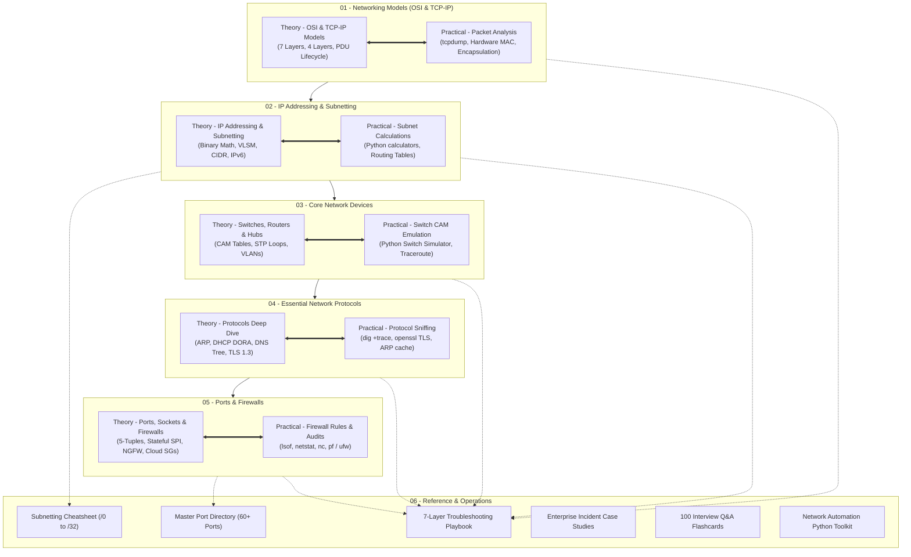

---
tags:
  - networking
  - curriculum
  - master-index
  - roadmap
date_created: 2026-10-11
---

# 🌐 Master Networking Curriculum & Knowledge Base

> [!ABSTRACT] Topic-Centric Hierarchical Architecture
> Welcome to your comprehensive Networking Masterclass. To ensure maximum clarity, the vault is organized **directly by the 5 core networking topics**.
> 
> Under each topic folder, you will find:
> 1. `Theory - ...`: In-depth architectural mechanics, RFC standards, and mathematical proofs.
> 2. `Practical - ...`: Terminal labs, live packet captures, and executable Python emulators.
> 
> Supporting cross-topic resources (cheatsheets, troubleshooting playbooks, interview questions, and automation scripts) are consolidated under `06 - Reference & Operations`.

---

## 🗺️ Master Curriculum Roadmap

---

## 📚 Complete Topic Directory & Direct Links

### Topic 1: Networking Models (OSI and TCP/IP)
*What it is: The conceptual frameworks that break down how data moves from an application on one computer through cables or Wi-Fi to an application on another computer.*
* 📖 **Theory:** [[Theory - OSI and TCP-IP Models|Theory: OSI 7 Layers & TCP/IP 4 Layers Architecture]]
* 🛠️ **Practical:** [[Practical - Packet Analysis and Encapsulation|Practical: Live tcpdump Packet Analysis & Interface Inspection]]

---

### Topic 2: IP Addressing and Subnetting
*What it is: How every device on a network is identified and how large networks are broken down into smaller, manageable pieces.*
* 📖 **Theory:** [[Theory - IP Addressing and Subnetting|Theory: IPv4/IPv6 Binary Foundations, VLSM & CIDR]]
* 🛠️ **Practical:** [[Practical - Subnet Calculations and Routing Tables|Practical: Programmatic Subnet Calculations & Kernel Routing Table Diagnostics]]

---

### Topic 3: Core Network Devices (Switches, Routers, and Hubs)
*What it is: The physical and virtual hardware that builds, connects, and directs traffic between local and external networks.*
* 📖 **Theory:** [[Theory - Core Devices and Switching|Theory: Collision vs. Broadcast Domains, Switch CAM Tables, STP & VLANs]]
* 🛠️ **Practical:** [[Practical - Switch CAM and Topology Emulation|Practical: Python Switch CAM Simulator & Traceroute TTL Inspection]]

---

### Topic 4: Essential Network Protocols (DNS, DHCP, HTTP/HTTPS, ARP)
*What it is: The digital rules devices use to talk to each other, assign addresses, and translate names.*
* 📖 **Theory:** [[Theory - Network Protocols Deep Dive|Theory: ARP Resolution, DHCP DORA Process, DNS Tree Hierarchy & TLS 1.3 Handshake]]
* 🛠️ **Practical:** [[Practical - Protocol Sniffing and Handshakes|Practical: DNS Query Sniffing, dig +trace, OpenSSL Handshakes & ARP Audits]]

---

### Topic 5: Ports and Firewalls (Traffic Control and Security)
*What it is: How operating systems direct incoming data to the right application and how networks block unwanted or malicious traffic.*
* 📖 **Theory:** [[Theory - Ports, Sockets and Firewalls|Theory: Socket 5-Tuples, Stateful Packet Inspection (SPI), NGFW & Cloud Security Groups]]
* 🛠️ **Practical:** [[Practical - Firewall Rules and Port Auditing|Practical: Socket Auditing (lsof), Netcat Port Probes & macOS pf / Linux ufw Firewalls]]

---

### Topic 6: Reference & Operations Toolkit
* 📊 **CIDR & Subnetting Table:** [[Subnetting & CIDR Master Cheatsheet]]
* 🚪 **Master Port Directory:** [[Master Port & Protocol Directory]]
* 🩺 **Troubleshooting Playbook:** [[7-Layer Network Troubleshooting Playbook]]
* 🏢 **Enterprise Incident Case Studies:** [[Enterprise Networking Case Studies]]
* 🎯 **Interview & Exam Prep:** [[100 Essential Networking Questions & Answers]]
* 🐍 **Python Automation Scripts:** [[Network Automation & Python Scripts]]

---

## 💡 How to Study in Obsidian

1. **Keep the Topic Intact:** When studying Topic 1, open its folder. Both the deep architecture theory and its hands-on terminal lab sit right next to each other.
2. **Dual-Pane View:** Open the **Theory** note on the left and `Cmd + Click` the matching **Practical** note on the right for simultaneous reading and execution.
3. **Interactive Graph View:** Hit `Cmd + G` (Mac) to view how every topic naturally bridges into reference guides and diagnostic playbooks.
