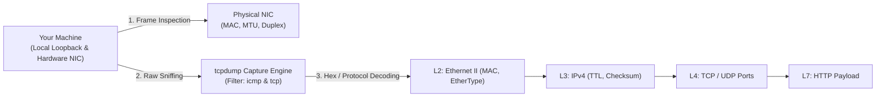
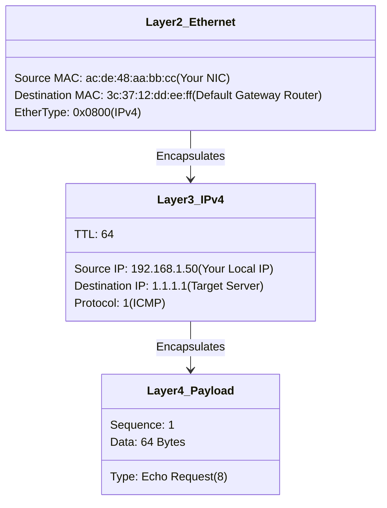

---
tags:
  - networking
  - packet-analysis
  - tcpdump
  - wireshark
  - practical
  - labs
date_created: 2026-10-11
module: 1
track: Practical
theory_counterpart: "[[01 - Networking Models (OSI and TCP-IP)]]"
---

# 🛠️ Practical 01: Packet Analysis, Encapsulation & Interface Inspection

> [!ABSTRACT] Lab Objectives
> In this hands-on lab, you will move from theoretical diagrams to raw hardware inspection and packet analysis. You will discover physical link properties, inspect your machine's burned-in MAC address, capture live Ethernet frames with `tcpdump`, and trace the decapsulation of application data.
> 
> * **Estimated Lab Duration:** ~1 Hour 30 Mins
> * **Required Tools:** macOS Terminal (or Linux Bash), `ifconfig` / `ip`, `tcpdump`, `curl`, `lsof`
> * **Direct Theory Companion:** [[01 - Networking Models (OSI and TCP-IP)]]

---

## Lab Architecture Diagram



---

## Lab 1.1: Physical & Data Link Layer Hardware Inspection

### Task 1: Audit Physical Network Adapters
Inspect your system's network hardware interfaces to identify their Layer 1 and Layer 2 attributes:

```bash
# On macOS:
ifconfig -a

# On Linux:
ip link show
```

### Analysis Checklist:
Find your primary active interface (typically `en0` on macOS Wi-Fi/Ethernet, or `eth0`/`wlan0` on Linux):
1. **Layer 2 MAC Address:** Look for the `ether` field (e.g., `ac:de:48:11:22:33`). This is the EUI-48 physical hardware address.
2. **Layer 1 Physical Status:** Look for `media` (e.g., `media: autoselect (1000baseT <full-duplex>)`).
   * `1000baseT` indicates 1 Gbps Gigabit Ethernet.
   * `<full-duplex>` indicates simultaneous bidirectional transmission.
3. **Layer 2 Maximum Transmission Unit:** Look for `mtu 1500`. This is the maximum frame payload before Layer 3 packet fragmentation occurs.

### Task 2: Decode Vendor OUI from Hardware MAC
Every network interface card manufacturer is assigned a 24-bit Organizationally Unique Identifier (OUI) by the IEEE. Extract the first 3 octets (first 6 hexadecimal digits) of your MAC address and query the vendor registry:

```bash
# Example query for MAC starting with ac:de:48
curl -s "https://api.macvendors.com/ac:de:48"
```
*Expected Output:* Manufacturer name (e.g., `Apple, Inc.`, `Intel Corporate`, `Realtek Semiconductor`).

---

## Lab 1.2: Capture and Deconstruct Live Ethernet Frames with `tcpdump`

`tcpdump` is the industry-standard command-line packet analysis utility. We will capture live ICMP frames and examine every byte across the protocol layers.

### Step 1: Launch Packet Capture
Open a terminal window and execute:

```bash
sudo tcpdump -i en0 -e -vvv -c 2 icmp
```
* **`-i en0`**: Listen on interface `en0`.
* **`-e`**: Print the Layer 2 Ethernet frame header (Source MAC, Destination MAC, EtherType).
* **`-vvv`**: Maximum verbosity (decodes TTL, IP flags, Identification, Checksum).
* **`-c 2`**: Stop automatically after capturing 2 packets.
* **`icmp`**: Berkeley Packet Filter (BPF) syntax restricting capture to ICMP traffic.

### Step 2: Generate Network Traffic
In a separate terminal window, ping Cloudflare's public resolver:

```bash
ping -c 2 1.1.1.1
```

### Step 3: Deconstruct the Captured Output

Examine your `tcpdump` terminal output line-by-line:

```text
20:30:15.123456 ac:de:48:aa:bb:cc > 3c:37:12:dd:ee:ff, ethertype IPv4 (0x0800), length 98:
    (tos 0x0, ttl 64, id 54321, offset 0, flags [none], proto ICMP (1), length 84)
    192.168.1.50 > 1.1.1.1: ICMP echo request, id 1234, seq 1, length 64
```



> [!IMPORTANT] Critical Observation: Destination MAC vs. Destination IP
> Notice that while the **Destination IP** is `1.1.1.1` (thousands of miles away), the **Destination MAC** is `3c:37:12:dd:ee:ff` (your local router in the room with you!). Layer 2 addresses only travel **one single hop**.

---

## Lab 1.3: Deep Transport (L4) and Presentation (L6) Handshake Tracing

Using `curl` with verbose debugging flags allows you to trace TCP socket establishment, TLS certificate verification, and HTTP payload transfer:

```bash
curl -Iv https://www.google.com 2>&1 | head -n 35
```

### Deconstructing the Terminal Output:

```text
*   Trying 142.250.190.46:443...
* Connected to www.google.com (142.250.190.46) port 443
```
👉 **Layer 4 (Transport):** TCP 3-way handshake established a reliable socket connection on port 443.

```text
* ALPN: offers h2, http/1.1
* SSL connection using TLSv1.3 / AEAD-CHACHA20-POLY1305-SHA256
* Server certificate:
*  subject: CN=*.google.com
*  issuer: C=US; O=Google Trust Services; CN=WR2
```
👉 **Layer 6 (Presentation):** TLS 1.3 cryptographic session negotiation, cipher selection, and X.509 certificate trust verification.

```text
> GET / HTTP/2
> Host: www.google.com
> user-agent: curl/8.7.1
> accept: */*
< HTTP/2 200
< content-type: text/html; charset=ISO-8859-1
```
👉 **Layer 7 (Application):** HTTP/2 binary framed request and server response payload.

---

## Lab 1.4: Real-World Diagnostic Challenge: Loopback vs. Public Sockets

**The Scenario:**  
A developer runs a microservice on their Mac using Node.js or Python. They can access it in their local browser at `http://localhost:8080`, but a coworker sitting next to them on the office Wi-Fi receives `ERR_CONNECTION_REFUSED` when visiting `http://192.168.1.50:8080`.

### Diagnostic Execution:
Run this command to inspect listening sockets:

```bash
lsof -nP -i :8080
```

### Evaluation Matrix:
| Socket Binding | Meaning | Accessible by Colleagues on LAN? |
|---|---|:---:|
| `127.0.0.1:8080` | Bound strictly to loopback interface (`lo0`) | ❌ **NO** (Packets from `en0` dropped by kernel) |
| `localhost:8080` | Resolves to loopback | ❌ **NO** |
| `0.0.0.0:8080` | Bound to **INADDR_ANY** (all interfaces) | ✅ **YES** |
| `192.168.1.50:8080`| Bound explicitly to physical LAN IP | ✅ **YES** |

**The Fix:**  
Ensure the backend server code binds to `0.0.0.0` rather than `localhost` or `127.0.0.1`!
