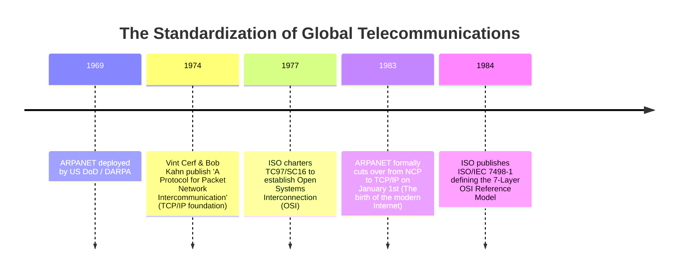
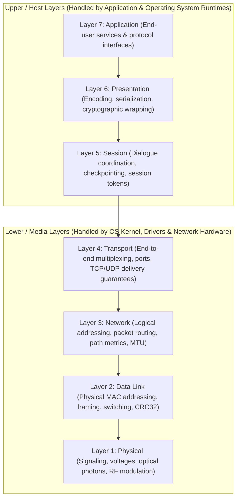
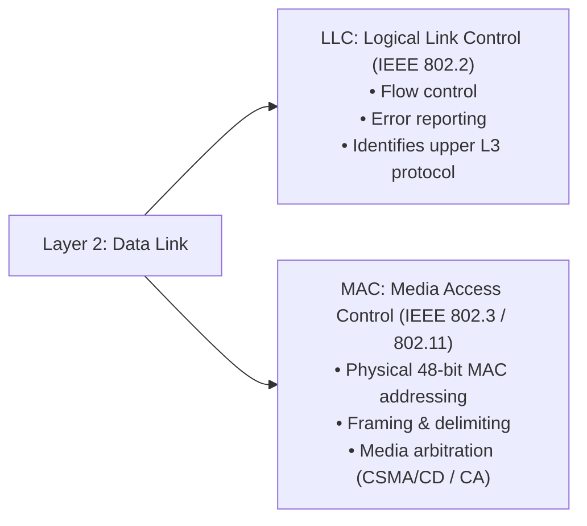
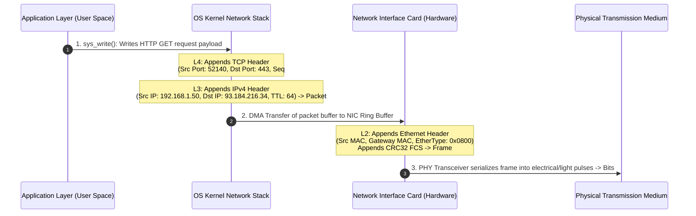

---
tags:
  - networking
  - architecture
  - osi-model
  - tcp-ip
  - theory
aliases:
  - OSI Model
  - TCP/IP Stack
  - Protocol Data Units
  - Encapsulation
date_created: 2026-10-11
module: 1
track: Theory
practical_counterpart: "[[01 - Packet Analysis, Encapsulation and Interface Inspection]]"
---

# 📖 Theory 01: Networking Models (OSI & TCP/IP Deep Dive)

> [!ABSTRACT] Executive Overview
> Modern digital communication is made possible through standard abstraction frameworks. Without reference models, heterogeneous computing devices (e.g., an x86 server running Linux, an Apple Silicon laptop, and an embedded IoT microcontroller) could not interchange data over electrical copper wires, fiber optics, or radio spectrums.
> 
> * **Estimated Reading & Study Time:** ~2 Hours 45 Mins
> * **Prerequisites:** Basic familiarity with binary digits (bits) and operating system processes.
> * **Direct Lab Companion:** [[01 - Packet Analysis, Encapsulation and Interface Inspection]]

---

## 1. Historical Context: The Pre-Standardization Chaos

In the late 1960s through 1970s, computer networking was governed by proprietary vendor monopolies:
* **IBM SNA (Systems Network Architecture - 1974):** Hierarchical, mainframe-dependent, and closed.
* **DECnet (Digital Equipment Corporation - 1975):** Functioned only between Digital hardware running VMS/RSX.
* **Xerox Network Systems (XNS):** Precursor to Novell IPX/SPX.

Interconnecting an IBM mainframe with a DEC minicomputer required custom hardware protocol translators that cost tens of thousands of dollars. Two distinct efforts emerged to standardize digital communications:



> [!NOTE] Theory vs. Reality: The Protocol War
> While the **OSI model** won the educational and conceptual battle as the universal language of networking, the **TCP/IP model** won the practical war of implementation because its codebase was open-source, pragmatic, and freely integrated into the Berkeley Software Distribution (4.2BSD Unix) in 1983.

---

## 2. Exhaustive Deconstruction of the 7 OSI Layers

Memory aids:
* **Top to Bottom:** **A**ll **P**eople **S**eem **T**o **N**eed **D**ata **P**rocessing
* **Bottom to Top:** **P**lease **D**o **N**ot **T**hrow **S**ausage **P**izza **A**way



---

### Layer 1: Physical Layer (Bits / Symbols)

The Physical layer deals exclusively with the transmission and reception of unstructured raw bit streams over a physical medium.

#### 1. Signaling & Modulation Mechanics
Computers do not transmit ones and zeros; they transmit physical state changes:
* **Electrical Signaling (Copper):**
  * **NRZ (Non-Return-to-Zero):** High voltage = 1, low voltage = 0. Prone to clock drift over long runs of identical bits.
  * **Manchester Encoding:** Bit value defined by the transition direction at the center of the clock period (Low-to-High = 0, High-to-Low = 1). Used in legacy 10BASE-T Ethernet.
  * **PAM-4 (Pulse Amplitude Modulation 4-Level):** Transmits 2 bits per pulse using 4 distinct voltage levels ($-3, -1, +1, +3$ V). Used in modern 100G/400G high-speed Ethernet fabrics.
* **Optical Signaling (Fiber Optic Glass):**
  * **Single-Mode Fiber (SMF - 9µm core):** Uses 1310nm or 1550nm laser diodes. Minimal modal dispersion. Reach: 10km to 80km+.
  * **Multi-Mode Fiber (MMF - 50µm or 62.5µm core):** Uses 850nm VCSELs (Vertical-Cavity Surface-Emitting Lasers). Light bounces off core walls (modal dispersion). Reach: 300m to 550m.
* **Radio Frequency Modulation (Wireless 802.11):**
  * Uses QAM (Quadrature Amplitude Modulation) and OFDM/OFDMA to encode hundreds of bits per hertz across 2.4 GHz, 5 GHz, and 6 GHz spectrums.

#### 2. Physical Cables & Standards
* **Cat5e:** Up to 1 Gbps @ 100m (100 MHz bandwidth).
* **Cat6:** Up to 10 Gbps up to 55m, 1 Gbps @ 100m (250 MHz bandwidth).
* **Cat6a:** Up to 10 Gbps @ 100m (500 MHz bandwidth, shielded to prevent Alien Crosstalk).
* **Duplex Modes:**
  * **Half-Duplex:** Shared medium; cannot transmit and receive simultaneously (e.g., legacy hubs, raw Wi-Fi channels).
  * **Full-Duplex:** Dedicated TX and RX channels; simultaneous bidirectional wire-speed transmission.

---

### Layer 2: Data Link Layer (Frames)

The Data Link layer provides point-to-point and point-to-multipoint communication over a local physical link. It establishes boundaries in the raw bit stream and verifies transmission integrity.



#### 1. Anatomy of a MAC Address (EUI-48)
A 48-bit (6-byte) physical hardware address burned into the Network Interface Card (NIC):

```text
       0                   1                   2       Bytes
       0 1 2 3 4 5 6 7 8 9 0 1 2 3 4 5 6 7 8 9 0 1 2 3
      +-+-+-+-+-+-+-+-+-+-+-+-+-+-+-+-+-+-+-+-+-+-+-+-+
      |      Organizationally Unique Identifier (OUI) |
      +-+-+-+-+-+-+-+-+-+-+-+-+-+-+-+-+-+-+-+-+-+-+-+-+
         | |
         | +-> Bit 1: Universal / Local (U/L) -> 0 = Globally unique, 1 = Locally administered
         +---> Bit 0: Individual / Group (I/G) -> 0 = Unicast, 1 = Multicast / Broadcast

       3                   4                   5       Bytes
      +-+-+-+-+-+-+-+-+-+-+-+-+-+-+-+-+-+-+-+-+-+-+-+-+
      |        Network Interface Controller ID        |
      +-+-+-+-+-+-+-+-+-+-+-+-+-+-+-+-+-+-+-+-+-+-+-+-+
```

#### 2. The Ethernet II Frame Architecture
Every packet on an Ethernet network is wrapped inside this structure:

```text
+----------+--------+------------------+------------------+-----------+--------------------+----------+
| Preamble |  SFD   | Destination MAC  |    Source MAC    | EtherType |      Payload       |   FCS    |
| (7 Bytes)|(1 Byte)|    (6 Bytes)     |    (6 Bytes)     | (2 Bytes) | (46 - 1500 Bytes)  | (4 Bytes)|
+----------+--------+------------------+------------------+-----------+--------------------+----------+
```
* **Preamble (7 Bytes):** Repeating pattern `10101010` allowing receiving PHY circuits to synchronize clock frequency.
* **SFD (Start Frame Delimiter - 1 Byte):** Sequence `10101011` indicating that the next bit is the start of the destination MAC.
* **EtherType (2 Bytes):** Tells the receiving OS kernel which Layer 3 protocol engine must decode the payload:
  * `0x0800` $\implies$ IPv4
  * `0x86DD` $\implies$ IPv6
  * `0x0806` $\implies$ ARP (Address Resolution Protocol)
  * `0x8100` $\implies$ IEEE 802.1Q VLAN tagged frame
* **FCS (Frame Check Sequence - 4 Bytes):** 32-bit Cyclic Redundancy Check (CRC-32). If a single flipped bit is detected upon arrival, the frame is silently dropped by the NIC hardware buffer.

---

### Layer 3: Network Layer (Packets)

The Network layer provides logical addressing, routing decisions across heterogeneous intermediate networks, and handles fragmentation.

#### 1. IPv4 Packet Header Architecture (RFC 791)
A standard IPv4 header contains a minimum of 20 bytes (up to 60 bytes with options):

```text
 0                   1                   2                   3
 0 1 2 3 4 5 6 7 8 9 0 1 2 3 4 5 6 7 8 9 0 1 2 3 4 5 6 7 8 9 0 1
+-+-+-+-+-+-+-+-+-+-+-+-+-+-+-+-+-+-+-+-+-+-+-+-+-+-+-+-+-+-+-+-+
|Version|  IHL  |Type of Service|          Total Length         |
+-+-+-+-+-+-+-+-+-+-+-+-+-+-+-+-+-+-+-+-+-+-+-+-+-+-+-+-+-+-+-+-+
|         Identification        |Flags|      Fragment Offset    |
+-+-+-+-+-+-+-+-+-+-+-+-+-+-+-+-+-+-+-+-+-+-+-+-+-+-+-+-+-+-+-+-+
|  Time to Live |    Protocol   |         Header Checksum       |
+-+-+-+-+-+-+-+-+-+-+-+-+-+-+-+-+-+-+-+-+-+-+-+-+-+-+-+-+-+-+-+-+
|                       Source IP Address                       |
+-+-+-+-+-+-+-+-+-+-+-+-+-+-+-+-+-+-+-+-+-+-+-+-+-+-+-+-+-+-+-+-+
|                    Destination IP Address                     |
+-+-+-+-+-+-+-+-+-+-+-+-+-+-+-+-+-+-+-+-+-+-+-+-+-+-+-+-+-+-+-+-+
```

* **TTL (Time to Live - 8 bits):** Prevents packets from circulating forever during routing loops. Every Layer 3 router hop decrements TTL by 1. When it reaches 0, the router discards the packet and transmits an ICMP Type 11 (Time Exceeded) message to the source.
* **Protocol Field (8 bits):** Indicates the Layer 4 protocol:
  * `6` $\implies$ TCP
  * `17` $\implies$ UDP
  * `1` $\implies$ ICMP
* **Fragmentation Flags & Offset:**
  * **DF (Don't Fragment):** If set to 1 and packet size > interface MTU, router drops packet and sends back `ICMP Type 3 Code 4` (Fragmentation Needed). This powers **PMTUD** (Path MTU Discovery).
  * **MF (More Fragments):** Indicates subsequent packet fragments follow.

---

### Layer 4: Transport Layer (Segments / Datagrams)

The Transport layer manages end-to-end communication sessions, multiplexes connections using **Port Numbers**, and provides flow and congestion control.

#### 1. Deep Dive: TCP vs. UDP Header Mechanics

```text
                TCP Header (20 - 60 Bytes)                                 UDP Header (8 Bytes)
 0                   1                   2                   3      0                   1                   2                   3
 0 1 2 3 4 5 6 7 8 9 0 1 2 3 4 5 6 7 8 9 0 1 2 3 4 5 6 7 8 9 0 1  0 1 2 3 4 5 6 7 8 9 0 1 2 3 4 5 6 7 8 9 0 1 2 3 4 5 6 7 8 9 0 1
+-+-+-+-+-+-+-+-+-+-+-+-+-+-+-+-+-+-+-+-+-+-+-+-+-+-+-+-+-+-+-+-+  +-+-+-+-+-+-+-+-+-+-+-+-+-+-+-+-+-+-+-+-+-+-+-+-+-+-+-+-+-+-+-+-+
|          Source Port          |       Destination Port        |  |          Source Port          |       Destination Port        |
+-+-+-+-+-+-+-+-+-+-+-+-+-+-+-+-+-+-+-+-+-+-+-+-+-+-+-+-+-+-+-+-+  +-+-+-+-+-+-+-+-+-+-+-+-+-+-+-+-+-+-+-+-+-+-+-+-+-+-+-+-+-+-+-+-+
|                        Sequence Number                        |  |            Length             |            Checksum           |
+-+-+-+-+-+-+-+-+-+-+-+-+-+-+-+-+-+-+-+-+-+-+-+-+-+-+-+-+-+-+-+-+  +-+-+-+-+-+-+-+-+-+-+-+-+-+-+-+-+-+-+-+-+-+-+-+-+-+-+-+-+-+-+-+-+
|                    Acknowledgment Number                      |
+-+-+-+-+-+-+-+-+-+-+-+-+-+-+-+-+-+-+-+-+-+-+-+-+-+-+-+-+-+-+-+-+
|  Data | Reserved|C|E|U|A|P|R|S|F|                             |
| Offset|         |W|C|R|C|S|S|Y|I|        Window Size          |
|       |         |R|E|G|K|H|T|N|N|                             |
+-+-+-+-+-+-+-+-+-+-+-+-+-+-+-+-+-+-+-+-+-+-+-+-+-+-+-+-+-+-+-+-+
|           Checksum            |         Urgent Pointer        |
+-+-+-+-+-+-+-+-+-+-+-+-+-+-+-+-+-+-+-+-+-+-+-+-+-+-+-+-+-+-+-+-+
```

#### 2. Key TCP Reliability Engines
* **Sequence & ACK Numbers:** Tracks individual bytes transmitted. Receiver confirms byte reception with `ACK = Expected Next Byte`.
* **Flow Control (Sliding Window):** The receiver advertises its available buffer window (`Window Size`). If receiver buffer fills up, it shrinks window to 0, ordering the sender to pause.
* **Congestion Control Algorithms:** Prevent network pipe collapse:
  * **TCP Reno / NewReno:** Multiplicative decrease upon packet loss.
  * **TCP Cubic:** Standard Linux kernel algorithm; uses cubic polynomial window growth.
  * **Google BBR (Bottleneck Bandwidth and RTT):** Model-based algorithm measuring actual pipe capacity rather than treating packet loss as congestion.

---

### Layer 5: Session Layer

* **Role:** Manages the lifecycle (establishment, maintenance, termination) of dialogues between applications.
* **Key Mechanisms:**
  * **Dialogue Separation:** Enforces Half-Duplex (token passing) or Full-Duplex communications.
  * **Checkpointing / Synchronization:** Inserts major and minor sync points into byte streams. In long-running transfers, a failure rolls back to the last checkpoint rather than starting from byte 0.
* **Protocols & Interfaces:** NetBIOS, RPC (Remote Procedure Call), SOCKS5 proxy session handshakes.

---

### Layer 6: Presentation Layer

* **Role:** Deals with the syntactic structure and semantic representation of the data. Ensures data sent from one system can be read by another regardless of internal CPU architecture.
* **Key Functions:**
  1. **Character Encoding & Serialization:** ASCII, UTF-8, UTF-16, Little-Endian vs. Big-Endian conversion, Protocol Buffers, ASN.1.
  2. **Data Compression:** Gzip, Brotli, Deflate, Zstandard.
  3. **Cryptographic Wrapping:** TLS/SSL encryption and decryption primitives.

---

### Layer 7: Application Layer

* **Role:** Exposes network communication primitives directly to user-facing applications and operating system software.
* **Protocols:** HTTP/1.1, HTTP/2, HTTP/3 (QUIC), DNS, DHCP, SSH, SMTP, IMAP, SNMP, BGP.

---

## 3. The 4-Layer TCP/IP Model & Comparative Mapping

The TCP/IP model (RFC 1122) collapsed the theoretical separations of OSI into an engineering-oriented stack:

| OSI Layer # | OSI Layer Name | TCP/IP Layer Equivalent | Protocol Data Unit (PDU) | Primary Data Structures & Protocols |
|:---:|:---:|:---:|:---:|:---|
| **7** | Application | rowspan="3" **Application** | **Data / Payload** | HTTP, DNS, SSH, DHCP, TLS, JSON, WebSockets |
| **6** | Presentation | | **Data** | |
| **5** | Session | | **Data** | |
| **4** | Transport | **Transport (Host-to-Host)** | **Segment** (TCP) / **Datagram** (UDP) | TCP, UDP, SCTP, QUIC |
| **3** | Network | **Internet** | **Packet** | IPv4, IPv6, ICMP, IPsec, BGP, OSPF |
| **2** | Data Link | rowspan="2" **Network Access (Link)** | **Frame** | Ethernet (802.3), Wi-Fi (802.11), ARP*, PPP |
| **1** | Physical | | **Bits / Symbols** | RJ-45, Fiber Optic Transceivers, RF Antennas |

---

## 4. Encapsulation & Decapsulation: The Complete Data Journey

When an engineer issues `curl https://example.com/api` in their terminal, data traverses the entire stack:



### The Multiplexing Demarcation Chain (Decapsulation)
When the receiving server receives raw bits from the wire, how does it know where to route the data?

```text
[ Ethernet Frame Header ] -> EtherType: 0x0800 -> Hands to IPv4 Subsystem
       [ IPv4 Packet Header ] -> Protocol: 6 -> Hands to TCP Subsystem
              [ TCP Segment Header ] -> Destination Port: 443 -> Hands to Nginx Web Server Process
                     [ TLS / HTTP Payload ] -> Read by Application Runtime
```

---

## 5. Review & Self-Assessment Worksheet

1. **Question:** What is the technical difference between an Ethernet *Frame* and an IP *Packet*?
   * *Answer:* An IP Packet is a Layer 3 PDU containing end-to-end logical addresses that persist unchanged across all router hops. An Ethernet Frame is a Layer 2 PDU containing physical hop-to-hop MAC addresses; it is stripped, destroyed, and rebuilt with new MAC addresses at every single router boundary.
2. **Question:** At which OSI layer does TLS (Transport Layer Security) operate?
   * *Answer:* Conceptually, TLS performs Presentation (Layer 6) tasks (encryption, cipher negotiation). However, in the TCP/IP stack, TLS operates inside the Application layer (Layer 7 payload) as an encapsulation wrapper around application protocols like HTTP before passing down to Layer 4 TCP.
3. **Question:** What does an EtherType value of `0x86DD` tell the receiving network interface?
   * *Answer:* It informs the operating system kernel that the payload of the Ethernet frame is an **IPv6** packet.

---

> [!TIP] Next Step: Practical Verification
> Now that you understand the theoretical lifecycle of frames, packets, and segments, switch to the terminal lab companion:  
> 👉 **[[01 - Packet Analysis, Encapsulation and Interface Inspection]]**
