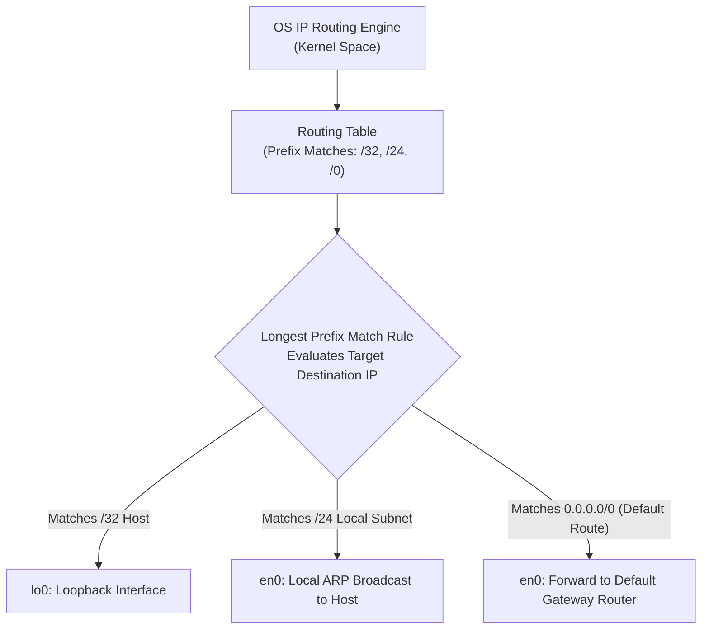

---
tags:
  - networking
  - ip-addressing
  - subnetting
  - python
  - routing
  - practical
date_created: 2026-10-11
module: 2
track: Practical
theory_counterpart: "[[02 - IP Addressing and Subnetting Architecture]]"
---

# 🛠️ Practical 02: Subnetting Mastery, Routing Table & IP Diagnostics

> [!ABSTRACT] Lab Objectives
> In this lab, you will put binary subnetting mechanics into active practice. You will execute programmatic network calculations using Python, dissect the host kernel's routing table (`netstat` / `ip route`), observe the Longest Prefix Match rule in action, and audit IPv6 link-local autoconfiguration.
> 
> * **Estimated Lab Duration:** ~1 Hour 30 Mins
> * **Required Tools:** macOS Terminal (or Linux Bash), Python 3, `netstat`, `route` / `ip`
> * **Direct Theory Companion:** [[02 - IP Addressing and Subnetting Architecture]]

---

## Lab Architecture Diagram



---

## Lab 2.1: Python Programmatic Subnetting Calculator

Python includes a standard library module (`ipaddress`) specifically engineered for network calculations. Run this script in your terminal to calculate any CIDR block parameters instantly:

```bash
python3 -c '
import ipaddress

def inspect_subnet(cidr_str):
    net = ipaddress.IPv4Network(cidr_str, strict=False)
    print("=" * 60)
    print(f"Subnet Analysis for: {net}")
    print("=" * 60)
    print(f"Network Address:       {net.network_address}")
    print(f"Broadcast Address:     {net.broadcast_address}")
    print(f"Subnet Netmask:        {net.netmask}")
    print(f"Wildcard Hostmask:     {net.hostmask}")
    print(f"Total IP Addresses:    {net.num_addresses}")
    print(f"Usable Host Capacity:  {max(0, net.num_addresses - 2)}")
    if net.num_addresses > 2:
        print(f"Usable Host Range:     {net.network_address + 1} - {net.broadcast_address - 1}")
    else:
        print(f"Usable Host Range:     Point-to-Point Link ({net.network_address} - {net.broadcast_address})")
    print("=" * 60)

inspect_subnet("172.16.50.0/22")
'
```

### Self-Check Challenges:
Run the script with the following targets and verify the values match your manual calculations:
1. `10.200.100.0/26` (Should show 62 usable hosts, block size 64)
2. `192.168.1.128/29` (Should show 6 usable hosts, broadcast `.135`)
3. `10.0.0.0/30` (Should show 2 usable hosts, PtP link)

---

## Lab 2.2: Dissecting the Host Kernel Routing Table

Your computer maintains an internal routing table where routing decisions occur prior to frame encapsulation.

```bash
# On macOS:
netstat -rn -f inet

# On Linux:
ip route show
```

### Deconstructing Real-World Output:

```text
Routing tables
Internet:
Destination        Gateway            Flags        Netif Expire
default            192.168.1.1        UGSc           en0
127.0.0.1          127.0.0.1          UH             lo0
192.168.1          link#6             UCS            en0
192.168.1.1        3c:37:12:dd:ee:ff  UHLWIir        en0
192.168.1.50/32    127.0.0.1          UGSc           lo0
```

### Flag Interpretation:
* **`U` (Up):** Route is currently active and operational.
* **`G` (Gateway):** Traffic must be forwarded to an intermediate router (next-hop) rather than delivered directly.
* **`H` (Host):** Route targets a single specific host (`/32`) rather than a whole network.
* **`C` (Cloning / Connected):** Directly attached local subnet.

### The Longest Prefix Match (LPM) Decision Process:
When sending a packet to `142.250.190.46` (Google):
1. Does it match `192.168.1.50/32`? ❌ No.
2. Does it match `192.168.1.0/24`? ❌ No.
3. Does it match `default` (`0.0.0.0/0`)? ✅ **Yes!**
4. Action: Encapsulate into an Ethernet frame addressed to gateway MAC `3c:37:12:dd:ee:ff` and transmit out `en0`.

---

## Lab 2.3: IPv6 Interface Audit & Link-Local Mechanics

Inspect your machine's 128-bit IPv6 configuration:

```bash
ifconfig | grep "inet6"
# or on Linux: ip -6 addr show
```

### Inspection Tasks:
1. **Find Link-Local Address:** Locate the address prefixed with `fe80::` (e.g., `fe80::1c34:5678:9abc:def0%en0`).
   * *Note on Scope ID (`%en0`):* Because every physical link uses the identical `fe80::/10` prefix, the operating system requires an interface zone delimiter (`%en0`) to know which physical wire to send packets out.
2. **Ping the Local IPv6 Loopback:**
   ```bash
   ping6 -c 3 ::1
   ```
3. **Trace Path over Public IPv6:**
   ```bash
   traceroute6 -m 5 2001:4860:4860::8888
   ```

---

## Lab 2.4: Real-World Troubleshooting Simulation: The Subnet Mask Mismatch

**Scenario:**  
Two database servers are plugged into the same local switch:
* **Server A:** IP `192.168.1.100`, Mask `255.255.255.0` (`/24`)
* **Server B:** IP `192.168.1.200`, Mask `255.255.255.128` (`/25`)

**Symptom:**  
Server A can ping Server B, but Server B **cannot ping Server A**!

### Technical Root Cause:
* **Server A's View:** `192.168.1.200` falls within its `/24` subnet (`192.168.1.1` to `.254`). Server A believes Server B is local and broadcasts an ARP request.
* **Server B's View:** Server B is on subnet `192.168.1.128/25` (range `.128` to `.254`). When replying to Server A (`192.168.1.100`), Server B's bitwise AND indicates Server A is on an **external network**. Server B attempts to send the reply to its default gateway router rather than directly back to Server A. If the router has no route back, the packet is lost!
* **Remediation:** Correct Server B's mask to `/24`.
