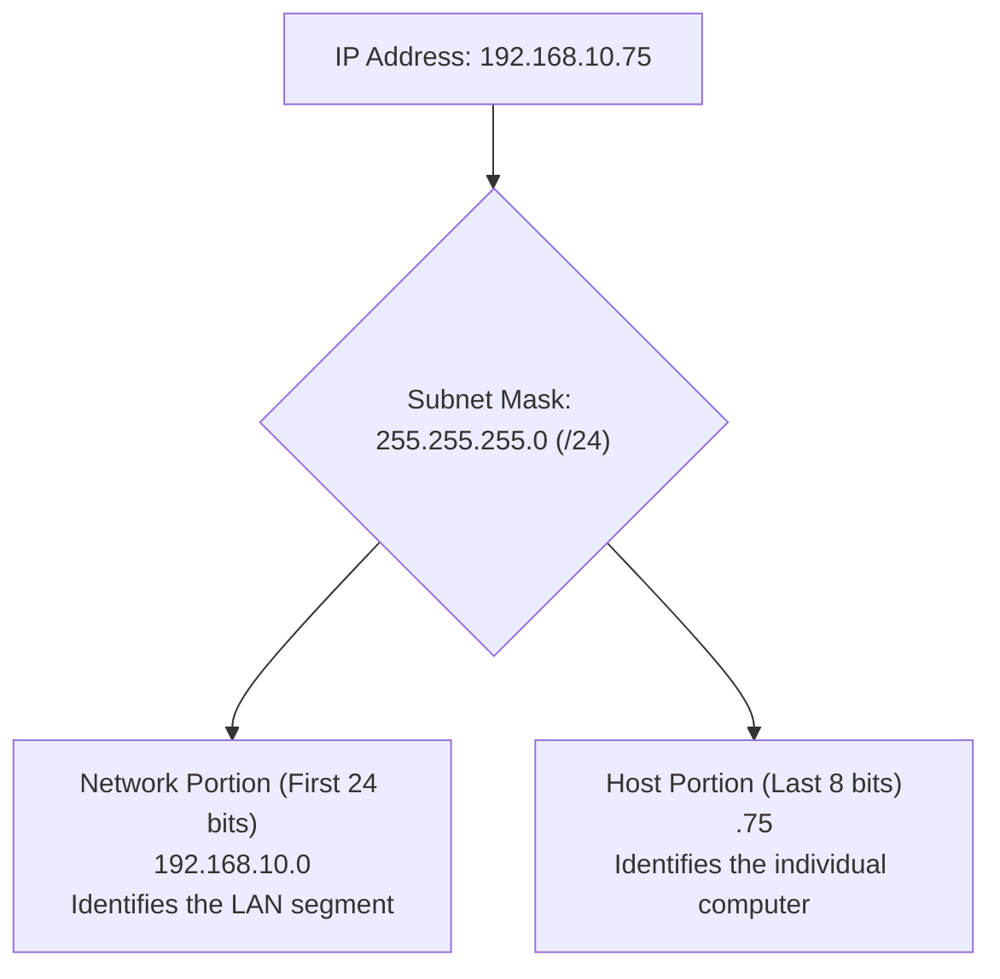
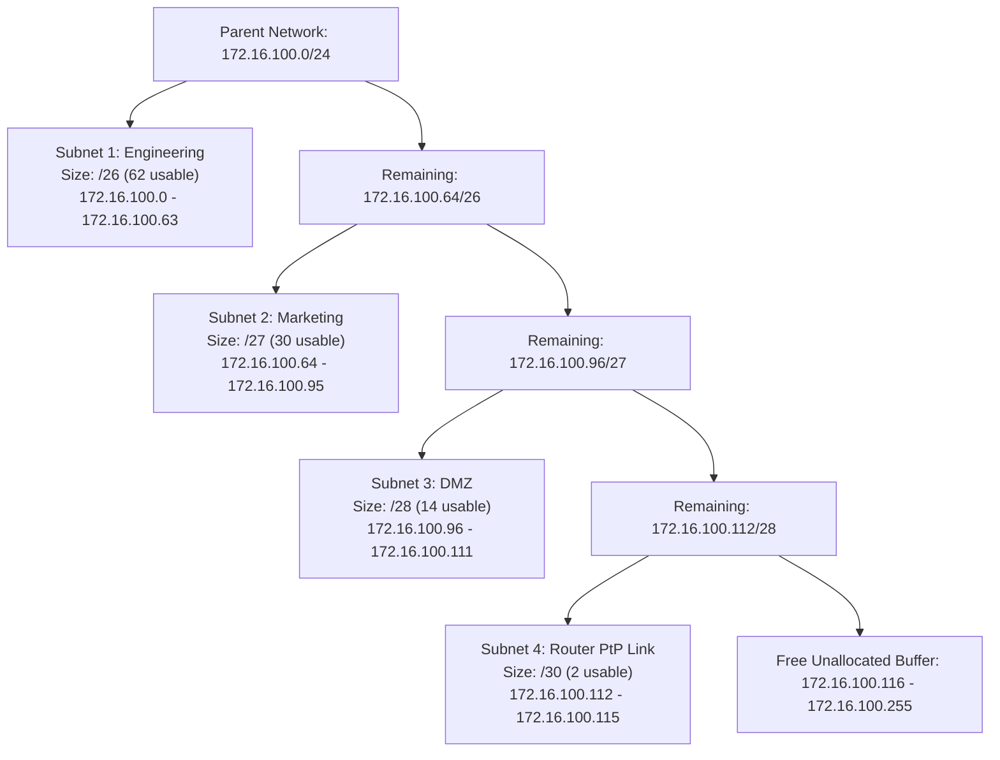

---
tags:
  - networking
  - ip-addressing
  - subnetting
  - vlsm
  - ipv6
  - theory
aliases:
  - IPv4 Architecture
  - Subnet Masks
  - CIDR Notation
  - Variable Length Subnet Masking
date_created: 2026-10-11
module: 2
track: Theory
practical_counterpart: "[[02 - Subnetting Mastery, Routing Table and IP Diagnostics]]"
---

# 📖 Theory 02: IP Addressing & Subnetting Architecture

> [!ABSTRACT] Executive Overview
> IP addressing provides logical, location-independent identification for billions of devices across the global Internet. While MAC addresses provide unique hardware identity at Layer 2, only hierarchical IP addresses enable routers to aggregate millions of routes into manageable routing tables.
> 
> * **Estimated Reading & Study Time:** ~3 Hours 00 Mins
> * **Prerequisites:** Basic understanding of binary powers of 2 ($2^0$ to $2^{16}$).
> * **Direct Lab Companion:** [[02 - Subnetting Mastery, Routing Table and IP Diagnostics]]

---

## 1. The Mathematical Foundation of IPv4

An IPv4 address is an unsigned **32-bit binary integer**. It is formatted as 4 octets separated by dots:
$$\text{IPv4 Address} = O_1 \cdot O_2 \cdot O_3 \cdot O_4 \quad \text{where } 0 \le O_n \le 255$$

Each octet represents an 8-bit unsigned integer ($2^8 = 256$ possible values):

```text
Decimal:       172     .      16     .     254     .       1
Binary:     10101100   .  00010000   .  11111110   .  00000001
Place Value: 128 64 32 16 8 4 2 1
```

### The 8-Bit Positional Value Table

| Bit Position | 7 | 6 | 5 | 4 | 3 | 2 | 1 | 0 |
|---|:---:|:---:|:---:|:---:|:---:|:---:|:---:|:---:|
| **Bit Power** | $2^7$ | $2^6$ | $2^5$ | $2^4$ | $2^3$ | $2^2$ | $2^1$ | $2^0$ |
| **Decimal Weight** | **128** | **64** | **32** | **16** | **8** | **4** | **2** | **1** |
| **Cumulative Value** | 128 | 192 | 224 | 240 | 248 | 252 | 254 | 255 |

---

## 2. Address Architecture: Network ID vs. Host ID

Every IP address is split into two logical components:
1. **Network Prefix (Network ID):** Identifies the specific network segment (analogous to a postal ZIP code).
2. **Host Identifier (Host ID):** Identifies the specific device or virtual interface on that segment (analogous to a house number).

The boundary between Network and Host is defined by the **Subnet Mask**.



### The Bitwise AND Algorithm
When an operating system sends a packet, it determines whether the destination is **local** (reach directly via Layer 2 ARP) or **remote** (send to default gateway router) by performing a bitwise AND between the target IP and the local subnet mask:

$$\text{Bitwise Logic: } 1 \land 1 = 1, \quad 1 \land 0 = 0, \quad 0 \land 1 = 0, \quad 0 \land 0 = 0$$

```text
Target IP:       192.168.10.75   -> 11000000 . 10101000 . 00001010 . 01001011
Subnet Mask:     255.255.255.0   -> 11111111 . 11111111 . 11111111 . 00000000
-------------------------------------------------------------------------------
Result Network:  192.168.10.0    -> 11000000 . 10101000 . 00001010 . 00000000
```

---

## 3. Historic Classful Addressing vs. Modern CIDR

In 1981, RFC 791 divided IPv4 into rigid classes based on leading bits:

| Class | Leading Bits | 1st Octet Range | Default Mask | CIDR | Usable Hosts per Network | Historic Purpose |
|:---:|:---:|:---:|:---:|:---:|:---:|---|
| **A** | `0` | `1.0.0.0` – `126.255.255.255` | `255.0.0.0` | `/8` | $16,777,214$ | Massive governments & corporations |
| **B** | `10` | `128.0.0.0` – `191.255.255.255`| `255.255.0.0` | `/16` | $65,534$ | Large universities & mid-tier enterprises |
| **C** | `110` | `192.0.0.0` – `223.255.255.255`| `255.255.255.0`| `/24` | $254$ | Small local offices & businesses |
| **D** | `1110`| `224.0.0.0` – `239.255.255.255`| None | N/A | N/A | Multicast groups (OSPF, streaming) |
| **E** | `1111`| `240.0.0.0` – `255.255.255.255`| None | N/A | N/A | Experimental / Reserved by IANA |

> [!CAUTION] Special Reserved Range: The Loopback Block
> The entire block `127.0.0.0/8` (`127.0.0.1` to `127.255.255.254`) is reserved exclusively for internal host loopback testing. Packets sent to `127.x.x.x` never exit the network interface card.

### CIDR (Classless Inter-Domain Routing - RFC 1519)
By 1993, classful allocation had exhausted Class B blocks while leaving Class A blocks largely empty. CIDR eliminated classes entirely, allowing masks to be split at **any arbitrary bit position**:
$$\text{Notation: } \text{IP} / N \quad (\text{where } N \text{ is the exact number of contiguous mask 1-bits})$$

---

## 4. Public vs. Private IP Addresses (RFC 1918)

To preserve the 4.3 billion IPv4 address pool, IANA designated three private address blocks that are **never routed across the public Internet**:

| RFC 1918 Block | Subnet Mask | CIDR | Total Usable Hosts | Typical Enterprise Deployment |
|---|---|:---:|---|---|
| `10.0.0.0` – `10.255.255.255` | `255.0.0.0` | `/8` | $16,777,214$ | Global enterprise corporate backbones, AWS VPCs |
| `172.16.0.0` – `172.31.255.255` | `255.240.0.0` | `/12` | $1,048,574$ | Mid-tier data centers, Docker default bridge |
| `192.168.0.0` – `192.168.255.255`| `255.255.0.0` | `/16` | $65,534$ | Home consumer routers, small branch offices |

### Other Crucial Reserved Blocks (RFC 3927 & RFC 6598)
* **APIPA (Automatic Private IP Addressing - `169.254.0.0/16`):** If a client is configured for DHCP but receives no response, the operating system assigns itself a random `169.254.x.x` address.  
  *Diagnostic rule:* If an engineer sees an APIPA address, **DHCP has failed or the physical link is down**.
* **Carrier-Grade NAT (CGNAT - `100.64.0.0/10`):** Used by mobile operators and ISPs to share one public IP among thousands of cellular subscribers.

---

## 5. Master Subnetting Formulas & The Magic Number Method

To calculate any subnet mentally, master four core equations:

1. **Host Bits ($H$):**
   $$H = 32 - \text{CIDR}$$
2. **Total IP Addresses in Subnet:**
   $$\text{Total IPs} = 2^H$$
3. **Usable Host Addresses:**
   $$\text{Usable Hosts} = 2^H - 2$$
   *(Subtract 2 because the first address is the Network ID and the last address is the Directed Broadcast address)*
4. **The Magic Number (Block Size):**
   $$\text{Magic Number} = 256 - \text{Mask Value in Interesting Octet}$$

---

### Comprehensive Reference Table: /20 to /32

| CIDR | Subnet Mask | Host Bits ($H$) | Total IPs ($2^H$) | Usable Hosts ($2^H - 2$) | Block Size (Step) | Primary Use Case |
|:---:|---|:---:|:---:|:---:|:---:|---|
| `/20` | `255.255.240.0` | 12 | 4,096 | 4,094 | 16 (in 3rd octet) | Large campus subnet |
| `/21` | `255.255.248.0` | 11 | 2,048 | 2,046 | 8 (in 3rd octet) | Data center pod |
| `/22` | `255.255.252.0` | 10 | 1,024 | 1,022 | 4 (in 3rd octet) | Large department |
| `/23` | `255.255.254.0` | 9 | 512 | 510 | 2 (in 3rd octet) | High-density office floor |
| `/24` | `255.255.255.0` | 8 | 256 | 254 | 1 (in 3rd octet) | Standard LAN building block |
| `/25` | `255.255.255.128` | 7 | 128 | 126 | 128 (in 4th octet)| Split LAN |
| `/26` | `255.255.255.192` | 6 | 64 | 62 | 64 (in 4th octet) | Branch office subnet |
| `/27` | `255.255.255.224` | 5 | 32 | 30 | 32 (in 4th octet) | Database cluster / Server pool |
| `/28` | `255.255.255.240` | 4 | 16 | 14 | 16 (in 4th octet) | DMZ / Load balancer tier |
| `/29` | `255.255.255.248` | 3 | 8 | 6 | 8 (in 4th octet) | Public WAN IP block allocation |
| `/30` | `255.255.255.252` | 2 | 4 | 2 | 4 (in 4th octet) | Legacy Point-to-Point router link |
| `/31` | `255.255.255.254` | 1 | 2 | 2 (RFC 3021) | 2 (in 4th octet) | Modern PtP link (No broadcast) |
| `/32` | `255.255.255.255` | 0 | 1 | 1 | 1 (in 4th octet) | Single Host / Loopback router ID |

---

## 6. Variable Length Subnet Masking (VLSM) Enterprise Case Study

In production network architecture, Fixed Length Subnet Masking (FLSM) wastes address space. VLSM allows an engineer to allocate custom-sized subnets from largest requirement to smallest.

### Architectural Scenario:
Allocate from parent network: `172.16.100.0/24` (256 Total IPs).
* **Engineering Team:** Requires 60 usable hosts.
* **Marketing Team:** Requires 28 usable hosts.
* **Server DMZ:** Requires 12 usable hosts.
* **Router PtP Link:** Requires 2 usable hosts.



---

## 7. IPv6 Architecture & The 128-Bit Era

IPv6 expands the address space from $2^{32} \approx 4.3 \times 10^9$ to $2^{128} \approx 3.4 \times 10^{38}$ addresses ($340\text{ undecillion}$ addresses).

### Format & Compression Rules
Represented as 8 groups of 4 hexadecimal characters (hextets) separated by colons:  
`2001:0db8:85a3:0000:0000:8a2e:0370:7334`

1. **Omit Leading Zeros:** `0db8` becomes `db8`, `0000` becomes `0`.
2. **Double Colon (`::`) Zero Compression:** Replace consecutive blocks of zeros with `::` (**only once per address**):  
   `2001:db8:85a3::8a2e:370:7334`

### Key IPv6 Address Scopes

| Scope | Prefix | Description & Behavior |
|---|:---:|---|
| **Loopback** | `::1/128` | Equivalent to IPv4 `127.0.0.1` |
| **Link-Local** | `fe80::/10` | Non-routable; autogenerated on every interface for local LAN communication |
| **Unique Local (ULA)** | `fc00::/7` (mostly `fd00::/8`) | Private routable internal addresses (analogous to RFC 1918) |
| **Global Unicast (GUA)** | `2000::/3` | Publicly routable Internet addresses |
| **Multicast** | `ff00::/8` | Replaces all IPv4 broadcast traffic |

---

> [!TIP] Next Step: Practical Verification
> Put these calculation principles to work with programmatic Python tools and routing table analysis:  
> 👉 **[[02 - Subnetting Mastery, Routing Table and IP Diagnostics]]**
