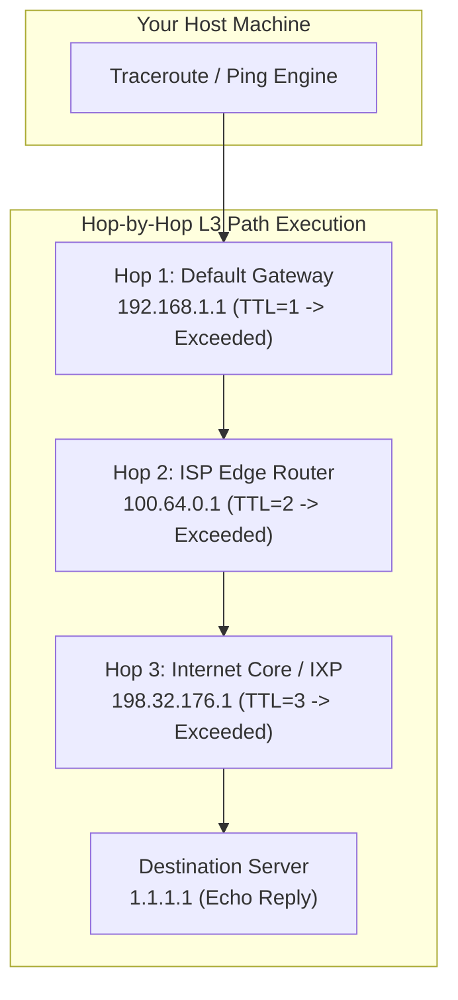

---
tags:
  - networking
  - switching
  - routing
  - python
  - traceroute
  - practical
date_created: 2026-10-11
module: 3
track: Practical
theory_counterpart: "[[03 - Core Network Devices and Switching Architecture]]"
---

# 🛠️ Practical 03: Switch MAC Table, Routing Paths & Topology Emulation

> [!ABSTRACT] Lab Objectives
> In this lab, you will explore the operational behavior of Layer 2 switches and Layer 3 routers. You will execute an interactive Python simulation of a switch's CAM learning and flooding algorithm, trace router hops and TTL decrements with `traceroute`, and inspect Layer 2 default gateway resolution.
> 
> * **Estimated Lab Duration:** ~1 Hour 30 Mins
> * **Required Tools:** macOS Terminal (or Linux Bash), Python 3, `traceroute`, `arp`, `netstat`
> * **Direct Theory Companion:** [[03 - Core Network Devices and Switching Architecture]]

---

## Lab Architecture Diagram



---

## Lab 3.1: Python Interactive Switch CAM Table Simulator

To observe how a physical switch learns MAC addresses and prevents frame flooding, run this standalone Python simulation:

```bash
python3 -c '
class VirtualSwitch:
    def __init__(self, port_count=4):
        self.ports = port_count
        self.cam_table = {}  # MAC -> Port

    def process_frame(self, ingress_port, src_mac, dst_mac, payload):
        print(f"\n[INCOMING FRAME] Port {ingress_port} | Src: {src_mac} -> Dst: {dst_mac} | Data: \"{payload}\"")
        
        # Step 1: Learn Source MAC
        if src_mac not in self.cam_table or self.cam_table[src_mac] != ingress_port:
            self.cam_table[src_mac] = ingress_port
            print(f"  --> [LEARNED] CAM Table Updated: {src_mac} is on Port {ingress_port}")
        
        # Step 2: Forwarding Decision
        if dst_mac == "FF:FF:FF:FF:FF:FF":
            flood_ports = [p for p in range(1, self.ports + 1) if p != ingress_port]
            print(f"  --> [BROADCAST] Flooding frame out ports: {flood_ports}")
        elif dst_mac in self.cam_table:
            egress_port = self.cam_table[dst_mac]
            if egress_port == ingress_port:
                print(f"  --> [FILTERED] Destination is on arrival port {ingress_port}. Dropping frame.")
            else:
                print(f"  --> [UNICAST FORWARD] Known MAC! Forwarding ONLY to Port {egress_port} (No Flooding!)")
        else:
            flood_ports = [p for p in range(1, self.ports + 1) if p != ingress_port]
            print(f"  --> [UNKNOWN UNICAST] MAC {dst_mac} not in CAM. Flooding out ports: {flood_ports}")

sw = VirtualSwitch(port_count=4)
# Scenario 1: Host A sends to Host B (Switch knows nothing)
sw.process_frame(1, "00:AA:AA:AA:AA:AA", "00:BB:BB:BB:BB:BB", "Hello Bob")

# Scenario 2: Host B replies to Host A (Switch now knows Host A!)
sw.process_frame(2, "00:BB:BB:BB:BB:BB", "00:AA:AA:AA:AA:AA", "Hi Alice, received!")

# Scenario 3: Host A sends another message to Host B (Both are now known!)
sw.process_frame(1, "00:AA:AA:AA:AA:AA", "00:BB:BB:BB:BB:BB", "Great, connection established.")
'
```

### Analysis of the Terminal Output:
* In **Scenario 1**, the switch did not know where `00:BB` was located, so it was forced to flood ports 2, 3, and 4.
* In **Scenario 2**, the switch already remembered that `00:AA` was on Port 1, so it forwarded the reply **exclusively to Port 1**.
* In **Scenario 3**, zero flooding occurred in either direction!

---

## Lab 3.2: Router Path Analysis & TTL Manipulation with `traceroute`

`traceroute` leverages the Layer 3 IPv4 **Time to Live (TTL)** field to discover intermediate routers:

```bash
traceroute -q 1 -m 12 1.1.1.1
```

### Technical Explanation of the Output:

```text
traceroute to 1.1.1.1 (1.1.1.1), 12 hops max, 52 byte packets
 1  192.168.1.1 (192.168.1.1)  2.412 ms
 2  10.100.0.1 (10.100.0.1)    8.145 ms
 3  172.16.20.1 (172.16.20.1)  14.220 ms
 4  one.one.one.one (1.1.1.1)  15.011 ms
```

1. **Hop 1 (TTL=1):** The packet arrives at your local router (`192.168.1.1`). The router decrements TTL from 1 to 0. Since TTL is 0, the router discards the packet and sends an `ICMP Time Exceeded (Type 11, Code 0)` error back to your Mac.
2. **Hop 2 (TTL=2):** The packet passes Hop 1 (TTL becomes 1), arrives at Hop 2, TTL becomes 0, drops, and returns another ICMP Time Exceeded packet.
3. This sequence repeats until reaching the final destination server.

---

## Lab 3.3: Inspecting Default Gateway Resolution via ARP

Discover which physical MAC address receives all outbound Internet traffic from your computer:

```bash
# 1. Identify default gateway IP address
GATEWAY_IP=$(netstat -rn -f inet | grep 'default' | head -n 1 | awk '{print $2}')
echo "Default Gateway IP: $GATEWAY_IP"

# 2. Query local ARP cache for the Gateway's MAC address
arp -n $GATEWAY_IP
```

*Takeaway:* Notice that whether you are communicating with Amazon, GitHub, or Cloudflare, your computer's network interface card addresses every single outbound Layer 2 frame to this **one single Gateway MAC address**.
