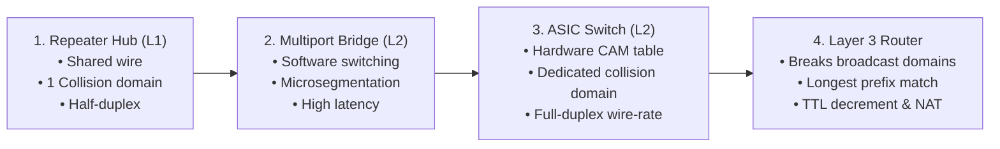
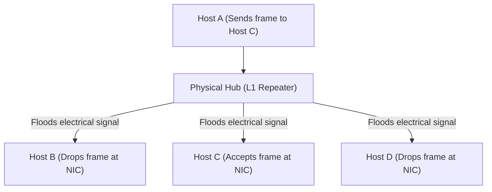
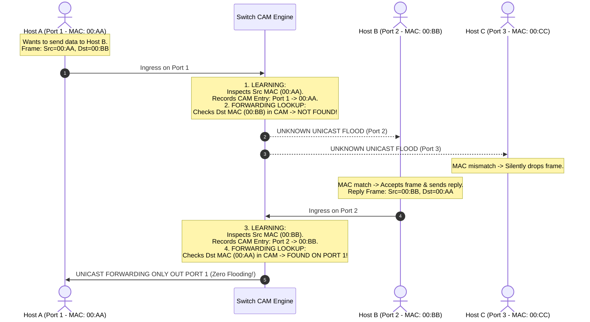
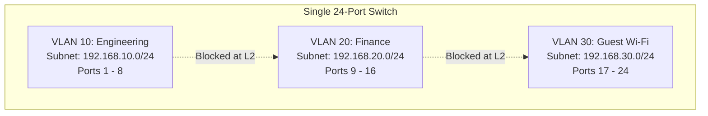
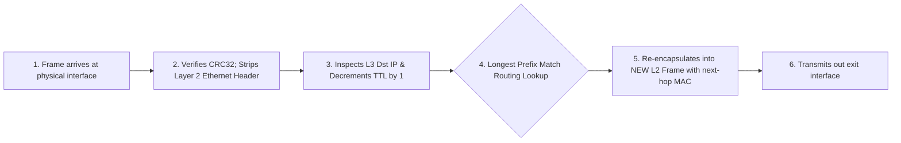

---
tags:
  - networking
  - switching
  - routing
  - hardware
  - spanning-tree
  - vlans
  - theory
aliases:
  - Switches Routers and Hubs
  - CAM Table Mechanics
  - Spanning Tree Protocol
  - Inter-VLAN Routing
date_created: 2026-10-11
module: 3
track: Theory
practical_counterpart: "[[03 - Switch MAC Table, Routing Paths and Network Topology Emulation]]"
---

# 📖 Theory 03: Core Network Devices & Switching Architecture

> [!ABSTRACT] Executive Overview
> Network infrastructure is built from specialized hardware operating at distinct layers of the OSI model. Understanding how switches direct frames using hardware CAM tables, how routers establish network boundaries and compute shortest paths, and how redundant topologies avoid fatal broadcast storms is foundational for any network architect.
> 
> * **Estimated Reading & Study Time:** ~2 Hours 30 Mins
> * **Prerequisites:** Completion of [[01 - Networking Models (OSI and TCP-IP)]] and [[02 - IP Addressing and Subnetting Architecture]].
> * **Direct Lab Companion:** [[03 - Switch MAC Table, Routing Paths and Network Topology Emulation]]

---

## 1. Network Device Evolution & Architectural Comparison

The fundamental design of local and wide-area networks has progressed through four distinct hardware generations:



### Comprehensive Comparison Matrix

| Architectural Feature | Network Hub | Layer 2 Switch | Layer 3 Router | Layer 3 Switch (Multilayer) |
|---|:---:|:---:|:---:|:---:|
| **Operating Layer** | **Layer 1** (Physical) | **Layer 2** (Data Link) | **Layer 3** (Network) | **Layer 2 & 3** |
| **Forwarding Entity** | None (Electrical Repeater) | Hardware MAC Address | Logical IP Address | MAC + IP (Hardware ASIC) |
| **Lookup Hardware** | None | CAM Table ($O(1)$) | Routing Table (TCAM / RAM) | TCAM (Ternary CAM) |
| **Collision Domains** | **1** (Entire device) | **1 per port** (Isolated) | **1 per port** | **1 per port** |
| **Broadcast Domains** | **1** (Entire device) | **1** per device / VLAN | **1 per port** (Blocks broadcasts) | **1 per VLAN** |
| **Duplex Capability** | Half-Duplex Only | Full-Duplex Simultaneous | Full-Duplex Simultaneous | Full-Duplex Simultaneous |
| **Industry Status** | **Obsolete** | **LAN Core / Access** | **WAN Edge / Gateway** | **Enterprise Campus Core** |

---

## 2. Hubs: Why Collision Domains Made Them Obsolete

A hub is a multi-port physical layer repeater. When an electrical signal arrives on Port 1, the hub simply amplifies the electrical voltage and floods it out Ports 2, 3, and 4 simultaneously.



### The Three Fatal Flaws of Hubs:
1. **The Shared Collision Domain:** If Host A and Host B transmit at the exact same instant, the electrical voltages collide on the physical copper wire, causing data corruption.
2. **CSMA/CD Overhead:** Nodes must run Carrier Sense Multiple Access with Collision Detection. When a collision occurs, both nodes must transmit a jam signal, wait for a random exponential backoff period, and retransmit. Network throughput drops exponentially under heavy load.
3. **Severe Security Vulnerability:** Any device plugged into any port on a hub can run a packet sniffer (like Wireshark) and read all network traffic from all other connected hosts in plaintext without attacking the network.

---

## 3. Layer 2 Switches: Hardware-Accelerated Microsegmentation

A modern network switch eliminates collisions by providing dedicated bandwidth to each port. Host A can transmit at 1 Gbps to Host C while Host B simultaneously transmits at 1 Gbps to Host D without interference.

### The CAM Table (Content Addressable Memory)
Standard computer RAM takes an address and retrieves data in $O(N)$ or $O(\log N)$ time. **CAM** is specialized associative memory that takes a 48-bit MAC address and returns the matching physical switch port in a **single clock cycle** ($O(1)$ lookup time).

### The Complete Switch Learning & Forwarding Lifecycle



### The Three Switch Forwarding Behaviors:
1. **Forward:** Destination MAC is known and associated with a different port. Forwarded only to that specific port.
2. **Filter / Drop:** Destination MAC is located on the same port where the frame entered. Frame is dropped.
3. **Flood:** Destination MAC is an **Unknown Unicast**, a **Broadcast** (`FF:FF:FF:FF:FF:FF`), or a **Multicast** (`01:00:5E:xx:xx:xx`). The frame is duplicated and transmitted out every active port *except* the ingress port.

---

## 4. Switching Loops & Spanning Tree Protocol (STP - IEEE 802.1D / 802.1w)

### The Broadcast Storm Threat
To prevent network outages caused by cable cuts or hardware failure, enterprise switches are wired with redundant links. However, because Layer 2 Ethernet frames **lack a TTL field**, any broadcast frame (e.g., an ARP request) will circulate infinitely between interconnected switches:

```text
[ Switch 1 ] <==== Redundant Link A ====> [ Switch 2 ]
     ||                                        ||
     +============= Redundant Link B ==========+
```
Within milliseconds, duplicate frames multiply exponentially, consuming 100% of link bandwidth, maxing out switch CPUs, and crashing the entire local network.

### The STP Resolution Algorithm:
1. **Elect the Root Bridge:** The switch with the lowest **Bridge Priority** (default 32768) + lowest MAC address becomes the logical root of the network.
2. **Elect Root Ports (RP):** Every non-root switch chooses the single physical port with the lowest path cost to reach the Root Bridge.
3. **Elect Designated Ports (DP):** One port per network segment is chosen to forward traffic.
4. **Block Alternate Ports (AP):** All remaining redundant ports are placed in a **Discarding / Blocking** state.
*If the primary link fails, STP recalculates and transitions the blocked port into Forwarding mode, restoring connectivity.*

---

## 5. Virtual LANs (VLANs) & Inter-VLAN Routing

### VLAN Segmentation (IEEE 802.1Q)
By default, all ports on a switch belong to a single broadcast domain. VLANs logically segment one physical switch into multiple isolated broadcast domains:



### IEEE 802.1Q Trunk Tagging
When traffic crosses a link connecting two switches (a **Trunk Link**), a 4-byte 802.1Q tag is inserted into the Ethernet frame:
* **TPID (Tag Protocol Identifier - 16 bits):** Set to `0x8100` to indicate an 802.1Q tagged frame.
* **PCP (Priority Code Point - 3 bits):** Quality of Service (QoS) prioritization.
* **VLAN ID (VID - 12 bits):** Supports up to $2^{12} = 4,096$ distinct VLANs.

### How Traffic Crosses VLAN Boundaries (Inter-VLAN Routing):
Because switches isolate VLANs at Layer 2, hosts in different VLANs cannot communicate without a Layer 3 device:
1. **Router-on-a-Stick:** A router is connected to the switch trunk via a single physical cable. The router interface is split into virtual sub-interfaces (e.g., `g0/0.10`, `g0/0.20`), each acting as the default gateway for a VLAN.
2. **Layer 3 Switch (SVI - Switched Virtual Interface):** Modern multilayer switches perform inter-VLAN routing internally using hardware ASICs at full wire speed (gigabits/terabits per second).

---

## 6. Layer 3 Routers: The Path Determination Engine

A router connects different logical IP networks. Its primary job is to consult its **Routing Table** and forward packets toward their ultimate destination.

### The Router Ingress-to-Egress Pipeline:



> [!IMPORTANT] The Golden Rule of Routing
> Across the entire Internet journey of a packet:
> * The **Source IP** and **Destination IP** remain **constant** (unless modified by NAT).
> * The **Source MAC** and **Destination MAC** **change at every single router hop**!

---

> [!TIP] Next Step: Practical Verification
> Test these hardware concepts by running our Python switch simulator and tracing router hops in the terminal:  
> 👉 **[[03 - Switch MAC Table, Routing Paths and Network Topology Emulation]]**
