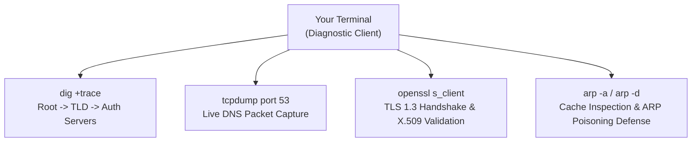

---
tags:
  - networking
  - protocols
  - packet-sniffing
  - dig
  - openssl
  - dns
  - tls
  - practical
date_created: 2026-10-11
module: 4
track: Practical
theory_counterpart: "[[04 - Essential Network Protocols Deep Dive]]"
---

# 🛠️ Practical 04: Protocol Sniffing, DNS, DHCP & TLS Handshakes

> [!ABSTRACT] Lab Objectives
> In this lab, you will capture and dissect essential network protocols in real time. You will sniff UDP port 53 DNS queries using `tcpdump`, perform full recursive-to-root iterative DNS traces using `dig`, inspect live TLS 1.3 certificate chains using `openssl`, and audit and flush your local ARP hardware cache.
> 
> * **Estimated Lab Duration:** ~1 Hour 45 Mins
> * **Required Tools:** macOS Terminal (or Linux Bash), `dig`, `tcpdump`, `openssl`, `arp`
> * **Direct Theory Companion:** [[04 - Essential Network Protocols Deep Dive]]

---

## Lab Architecture Diagram



---

## Lab 4.1: Real-Time DNS Packet Sniffing with `tcpdump`

Observe how DNS queries travel in lightweight UDP datagrams on Port 53.

### Step 1: Start the Packet Capture
Open Terminal Window 1 and run:

```bash
sudo tcpdump -i en0 -n -s 0 -vvv port 53
```
* **`-n`**: Do not convert IP addresses to hostnames (prevents recursive DNS capture loops).
* **`port 53`**: Restricts sniffing to DNS queries and replies.

### Step 2: Trigger a DNS Resolution Query
In Terminal Window 2, query Wikipedia's `A` and `AAAA` records:

```bash
dig wikipedia.org A +noall +answer
```

### Step 3: Deconstruct the Captured Packet
Examine the output captured in Terminal 1:

```text
20:45:10.123456 IP (tos 0x0, ttl 64, id 12345, proto UDP (17), length 59)
    192.168.1.50.51820 > 192.168.1.1.53: [udp sum ok] 45678+ A? wikipedia.org. (31)
20:45:10.145678 IP (tos 0x0, ttl 64, id 67890, proto UDP (17), length 75)
    192.168.1.1.53 > 192.168.1.50.51820: [udp sum ok] 45678 q: A? wikipedia.org. 1/0/0 wikipedia.org. [300] A 208.80.154.224 (47)
```

* **Ephemeral Port:** The client randomly allocated UDP port `51820` for this query.
* **Transaction ID:** Notice the matching identifier `45678`. This random 16-bit number prevents DNS spoofing/cache poisoning by ensuring replies match the request.
* **Flag `+`:** Indicates **Recursion Desired**.

---

## Lab 4.2: Tracing Iterative DNS Hierarchy with `dig +trace`

Perform a full iterative traversal from the 13 global root servers down to the authoritative answer:

```bash
dig +trace github.com
```

### Analysis of the 4 Stages:
1. **Stage 1 (Root Zone `.`)**: Your query contacts one of the 13 root authorities (`a.root-servers.net` to `m.root-servers.net`). It returns the list of `.com` Top-Level Domain (TLD) servers.
2. **Stage 2 (TLD Zone `.com`)**: Your machine queries a `.com` TLD server. The TLD server responds with a referral to GitHub's Authoritative Name Servers (`dns1.p08.nsone.net`).
3. **Stage 3 (Authoritative Zone `github.com`)**: Your machine queries NS1 directly. The authoritative server returns the final authoritative `A` record (`140.82.121.4`).

---

## Lab 4.3: Dissecting the TLS 1.3 Cryptographic Handshake

Use `openssl s_client` to inspect the handshake negotiation, supported ciphers, and certificate chain:

```bash
openssl s_client -connect google.com:443 -tls1_3 -servername google.com
```

### Output Inspection Points:
* **Certificate Chain:** Look for the hierarchical trust chain:  
  `0: CN = *.google.com` $\to$ `1: CN = WR2, O = Google Trust Services` $\to$ `Root CA`.
* **Session Details:** Look for:
  * `Protocol : TLSv1.3`
  * `Cipher : TLS_AES_256_GCM_SHA384` (Symmetric authenticated encryption).
  * `ALPN protocol: h2` (HTTP/2 negotiated).

---

## Lab 4.4: Local ARP Cache Audit and Dynamic Cache Flushing

View and manipulate your machine's Layer 2 hardware address bindings:

```bash
# 1. Print all resolved IP-to-MAC bindings
arp -a

# 2. Check the MAC of your default gateway
GATEWAY_IP=$(netstat -rn -f inet | grep 'default' | head -n 1 | awk '{print $2}')
arp -n $GATEWAY_IP

# 3. Flush a specific ARP cache entry (requires sudo)
sudo arp -d $GATEWAY_IP

# 4. Generate network traffic to trigger a new broadcast ARP request
ping -c 1 $GATEWAY_IP

# 5. Confirm the dynamic entry was successfully re-learned
arp -n $GATEWAY_IP
```
