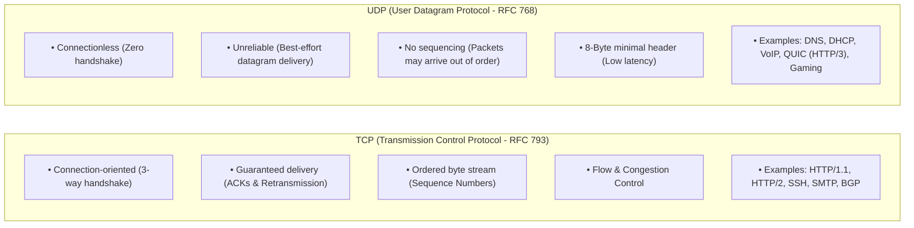
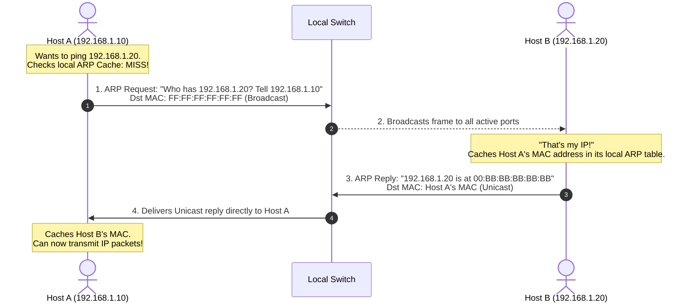
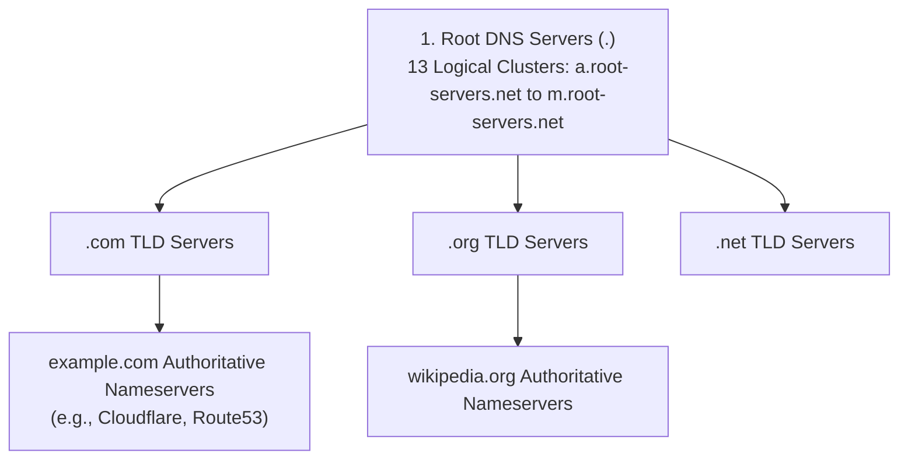
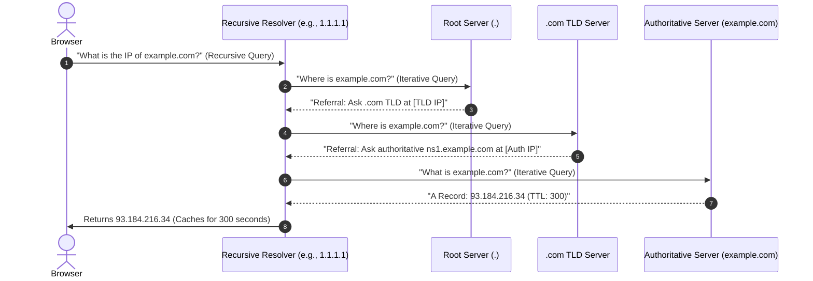

---
tags:
  - networking
  - protocols
  - dns
  - dhcp
  - arp
  - tls
  - http
  - theory
aliases:
  - Essential Network Protocols
  - DNS Resolution Architecture
  - DHCP DORA Process
  - TLS Handshake Mechanics
date_created: 2026-10-11
module: 4
track: Theory
practical_counterpart: "[[04 - Protocol Sniffing, DNS Queries, DHCP and TLS Handshake Analysis]]"
---

# 📖 Theory 04: Essential Network Protocols Deep Dive

> [!ABSTRACT] Executive Overview
> A physical and logical network infrastructure is only as useful as the protocols running on top of it. This module explores the foundational control and data plane protocols: how ARP binds Layer 3 to Layer 2, how DHCP configures hosts automatically, how DNS provides globally distributed name resolution, and how HTTP/HTTPS delivers secure application data.
> 
> * **Estimated Reading & Study Time:** ~2 Hours 45 Mins
> * **Prerequisites:** Completion of [[01 - Networking Models (OSI and TCP-IP)]] and [[02 - IP Addressing and Subnetting Architecture]].
> * **Direct Lab Companion:** [[04 - Protocol Sniffing, DNS Queries, DHCP and TLS Handshake Analysis]]

---

## 1. Transport Mechanics: TCP vs. UDP Dynamics

Application protocols rely on either TCP (reliable, connection-oriented) or UDP (fast, lightweight, connectionless):



### The TCP Three-Way Handshake & Connection Teardown

```text
                  CLIENT                                       SERVER
                    |                                             |
[CLOSED]            |                                             | [LISTEN]
                    | ------------ 1. SYN (Seq=100) ------------> |
[SYN_SENT]          |                                             | [SYN_RCVD]
                    | <--- 2. SYN-ACK (Seq=300, Ack=101) -------- |
[ESTABLISHED]       |                                             |
                    | ------------ 3. ACK (Ack=301) ------------> | [ESTABLISHED]
                    |                                             |
                    | <====== Data Exchange (Bidirectional) =====> |
                    |                                             |
[FIN_WAIT_1]        | ------------ 4. FIN (Seq=500) ------------> | [CLOSE_WAIT]
[FIN_WAIT_2]        | <--- 5. ACK (Ack=501) --------------------- |
                    | <--- 6. FIN (Seq=800) --------------------- | [LAST_ACK]
[TIME_WAIT]         | ------------ 7. ACK (Ack=801) ------------> | [CLOSED]
(Wait 2*MSL)        |                                             |
[CLOSED]            v                                             v
```

---

## 2. ARP (Address Resolution Protocol - RFC 826)

### The Hop-by-Hop Address Binding Problem
An operating system knows the target's IP address (e.g., `192.168.1.20`), but the local Ethernet network card can only deliver frames to a physical 48-bit MAC address. ARP bridges this Layer 3 to Layer 2 gap.



### The Three Variants of ARP:
1. **Standard ARP:** Resolves local IP to MAC on demand.
2. **Gratuitous ARP (GARP):** An unsolicited ARP announcement broadcasted by a host to announce its own IP/MAC binding to the entire LAN. Used to:
   * Detect duplicate IP address conflicts upon booting.
   * Update switch CAM tables during high-availability failover (e.g., Keepalived, VRRP).
3. **Proxy ARP:** A router replies to an ARP request on behalf of a target host located on another subnet, making the client believe the remote destination is locally attached.

---

## 3. DHCP (Dynamic Host Configuration Protocol - RFC 2131)

### Purpose & Port Assignments
DHCP automates the assignment of IP addresses, subnet masks, default gateways, and DNS server addresses. It operates on **UDP Port 67 (Server)** and **UDP Port 68 (Client)**.

### The 4-Step DORA Handshake

```text
       CLIENT (No IP: 0.0.0.0)                         DHCP SERVER
           |                                                |
           | ----- 1. DHCP DISCOVER (Broadcast) ----------> |
           |      Src: 0.0.0.0:68  Dst: 255.255.255.255:67  |
           |      "Are there any DHCP servers on this LAN?" |
           |                                                |
           | <---- 2. DHCP OFFER (Unicast / Broadcast) ---- |
           |      "I can lease you 192.168.1.100 for 24h"   |
           |                                                |
           | ----- 3. DHCP REQUEST (Broadcast) -----------> |
           |      "I accept 192.168.1.100 from Server 1"    |
           |                                                |
           | <---- 4. DHCP ACK (Acknowledgment) ----------- |
           |      "Confirmed! Here is your Gateway & DNS"   |
           v                                                v
```

### DHCP Lease Timers & Rebinding:
* **Lease Duration ($T$):** The total validity period (e.g., 24 hours).
* **Renewal Timer ($T_1 = 0.5 \times T$):** At 50% expiration (12 hours), client attempts to renew the lease by sending a **unicast** `DHCPREQUEST` directly to the original server.
* **Rebinding Timer ($T_2 = 0.875 \times T$):** At 87.5% expiration (21 hours), if the original server has not replied, the client broadcasts a `DHCPREQUEST` to **any** available DHCP server on the network.

---

## 4. DNS (Domain Name System - RFC 1035)

DNS provides a distributed, hierarchical database mapping human-readable hostnames to IP addresses. Operates on **UDP Port 53** (and **TCP Port 53** for responses exceeding 512 bytes and zone transfers).

### The Global Resolution Hierarchy



### Recursive vs. Iterative Query Flow



### Core DNS Record Types Reference

| Record | Name | Function | Example |
|:---:|---|---|---|
| **A** | Address | Maps hostname to IPv4 address | `example.com` $\to$ `93.184.216.34` |
| **AAAA** | IPv6 Address | Maps hostname to IPv6 address | `example.com` $\to$ `2606:2800:220:1:248:1893:25c8:1946` |
| **CNAME**| Canonical Name | Alias pointing to another domain | `www.example.com` $\to$ `example.com` |
| **MX** | Mail Exchange | Designates mail servers for domain | `mail.example.com` (Priority 10) |
| **TXT** | Text | Arbitrary metadata (SPF, DKIM, verification)| `"v=spf1 include:_spf.google.com ~all"` |
| **PTR** | Pointer | Reverse DNS lookup (IP $\to$ Hostname) | `34.216.184.93.in-addr.arpa` $\to$ `example.com` |
| **NS** | Name Server | Specifies authoritative name servers | `ns1.cloudflare.com` |
| **SOA** | Start of Authority | Primary zone metadata, admin email, serial | Zone serial number, refresh/retry timers |

---

## 5. Web Protocols: HTTP, HTTPS & TLS 1.3

### The TLS 1.3 Cryptographic Handshake (RFC 8446)
TLS 1.3 reduced the historical 2-round-trip TLS 1.2 handshake down to a single round-trip (1-RTT):

```text
CLIENT                                                   SERVER
  |                                                         |
  | ----- 1. ClientHello ---------------------------------> |
  |      • Supported Cipher Suites                          |
  |      • Client Diffie-Hellman Key Share                  |
  |      • SNI (Server Name Indication: example.com)        |
  |                                                         |
  | <---- 2. ServerHello ---------------------------------- |
  |      • Selected Cipher Suite (e.g., AES_256_GCM_SHA384) |
  |      • Server Diffie-Hellman Key Share                  |
  |      • Encrypted Server X.509 Certificate               |
  |      • Encrypted Finished Signature                     |
  |                                                         |
  | [Client verifies Certificate against OS Root CA Store]   |
  | [Both sides compute symmetric session key independently]|
  |                                                         |
  | <==== 3. Encrypted Application Data (HTTP/2 or HTTP/3) ==> |
```

---

> [!TIP] Next Step: Practical Verification
> Capture live DNS requests, trace root resolution with `dig`, and inspect TLS certificates in the terminal:  
> 👉 **[[04 - Protocol Sniffing, DNS Queries, DHCP and TLS Handshake Analysis]]**
