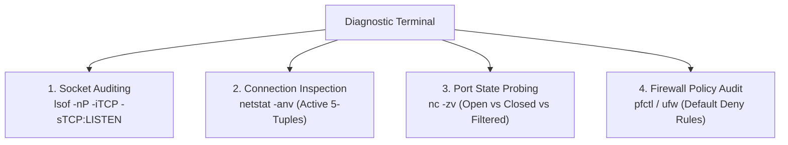

---
tags:
  - networking
  - security
  - firewalls
  - ports
  - sockets
  - auditing
  - practical
date_created: 2026-10-11
module: 5
track: Practical
theory_counterpart: "[[05 - Ports, Sockets, and Firewall Security Architectures]]"
---

# 🛠️ Practical 05: Firewall Rules, Port Auditing & Socket Inspection

> [!ABSTRACT] Lab Objectives
> In this lab, you will audit your operating system's listening network sockets, analyze active 5-tuple TCP connections, test the three distinct network responses to port scans using `nc` (netcat), and inspect stateful host firewall configurations on macOS (`pf`) and Linux (`ufw`).
> 
> * **Estimated Lab Duration:** ~1 Hour 30 Mins
> * **Required Tools:** macOS Terminal (or Linux Bash), `lsof`, `netstat`, `nc` (netcat), `pfctl` / `ufw`
> * **Direct Theory Companion:** [[05 - Ports, Sockets, and Firewall Security Architectures]]

---

## Lab Architecture Diagram



---

## Lab 5.1: Socket Auditing & Listening Ports Discovery

Identify every network daemon and process listening for incoming connections on your system:

```bash
lsof -nP -iTCP -sTCP:LISTEN
```
* **`-n`**: Prevents IP-to-hostname DNS lookups.
* **`-P`**: Prevents port-to-service name conversions (shows raw port numbers).
* **`-iTCP`**: Filters strictly for TCP network sockets.
* **`-sTCP:LISTEN`**: Shows only sockets actively listening for incoming connections.

### Deconstructing Real-World Output:

```text
COMMAND   PID USER   FD   TYPE             DEVICE SIZE/OFF NODE NAME
rapportd  412  abr    3u  IPv4 0x1234567890abcdef      0t0  TCP *:49159 (LISTEN)
node     8942  abr   22u  IPv6 0xabcdef1234567890      0t0  TCP *:3000 (LISTEN)
postgres 1120  abr    7u  IPv4 0xfedcba0987654321      0t0  TCP 127.0.0.1:5432 (LISTEN)
```

### Security & Exposure Analysis:
1. **`127.0.0.1:5432` (PostgreSQL):** Safe. Only accessible from inside this machine (loopback).
2. **`*:3000` (Node.js):** Exposed to the entire local Wi-Fi / Ethernet LAN.
3. **PID Tracking:** If you discover an unknown listening port, terminate it immediately using its PID: `kill -9 <PID>`.

---

## Lab 5.2: Dissecting Active 5-Tuple Network Sockets

Inspect active connections currently exchanging data:

```bash
netstat -anv | grep ESTABLISHED | head -n 10
```

### Anatomy of an Established Connection:

```text
Proto Recv-Q Send-Q  Local Address          Foreign Address        (state)
tcp4       0      0  192.168.1.50.52180     142.250.190.46.443     ESTABLISHED
```

* **Local 2-Tuple:** IP `192.168.1.50`, Port `52180` (Client ephemeral port).
* **Foreign 2-Tuple:** IP `142.250.190.46`, Port `443` (Target web server).
* **Protocol:** `tcp4`.
* **Buffer Queues:** `Recv-Q 0`, `Send-Q 0` indicates zero network congestion or application backlog.

---

## Lab 5.3: Probing the Three Responses to Network Port Scans

A remote port can exist in one of three states. Use `netcat` (`nc`) to observe each state:

```bash
# State 1: OPEN (Returns 0 / Connection Succeeded immediately)
nc -zv -w 2 google.com 443

# State 2: CLOSED (Returns 'Connection Refused' immediately - TCP RST packet received)
nc -zv -w 2 google.com 81

# State 3: FILTERED / FIREWALLED (Hangs until timeout - Packets silently dropped)
nc -zv -w 2 192.0.2.1 443
```

### Defense Implications:
* A server returning **`Connection Refused`** reveals to an attacker that the host is alive.
* A hardened firewall configured with **`DROP`** rather than `REJECT` forces attackers' port scanners to time out, significantly increasing scanning latency and masking host presence.

---

## Lab 5.4: Stateful Host Firewall Configuration (macOS `pf` / Linux `ufw`)

### macOS Packet Filter (`pf`) Inspection:
macOS includes the enterprise-grade BSD Packet Filter (`pf`) engine:

```bash
# Check if packet filter is active
sudo pfctl -s info

# View currently loaded firewall rules
sudo pfctl -s rules
```

### Example Production `pf.conf` Rule Structure:

```text
# 1. Default Policy: Block all unsolicited inbound traffic
block in all
pass out all keep state

# 2. Skip filtering on the local loopback interface
set skip on lo0

# 3. Allow incoming SSH only from a specific secure management subnet
pass in proto tcp from 10.10.0.0/24 to any port 22 keep state

# 4. Allow public inbound HTTPS web traffic
pass in proto tcp to any port 443 keep state
```

### Linux UFW Quick Security Hardening:

```bash
# 1. Enforce default deny posture
sudo ufw default deny incoming
sudo ufw default allow outgoing

# 2. Permit only required application ports
sudo ufw allow 22/tcp comment "SSH administration"
sudo ufw allow 443/tcp comment "HTTPS Web"

# 3. Enable firewall engine
sudo ufw enable
sudo ufw status verbose
```
