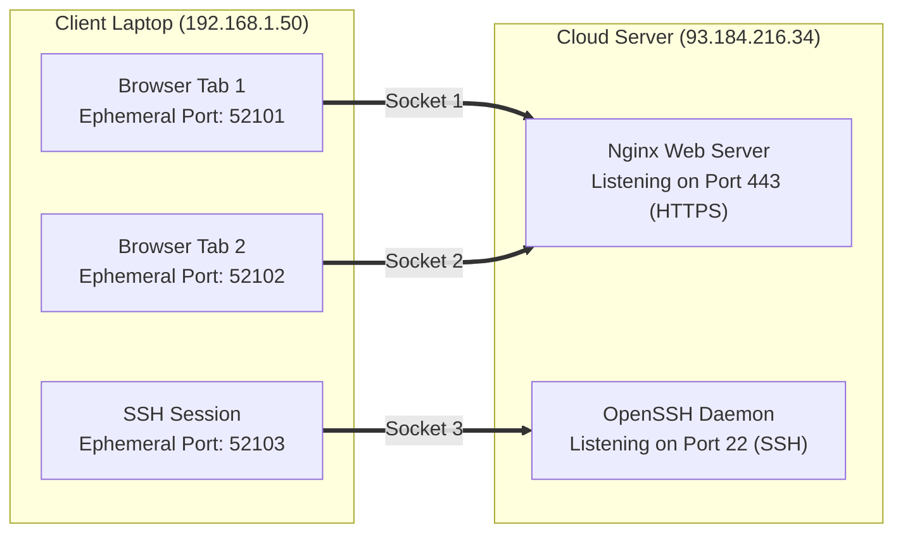
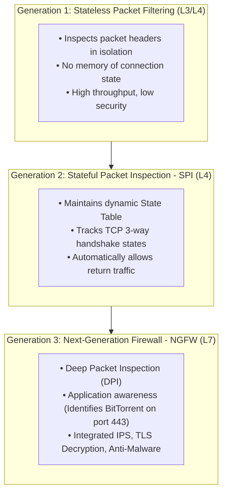

---
tags:
  - networking
  - security
  - firewalls
  - ports
  - sockets
  - ngfw
  - theory
aliases:
  - Ports and Firewalls
  - Stateful Packet Inspection
  - Next-Gen Firewalls
  - Cloud Security Groups
date_created: 2026-10-11
module: 5
track: Theory
practical_counterpart: "[[05 - Firewall Rules, Port Auditing and Socket Inspection]]"
---

# 📖 Theory 05: Ports, Sockets & Firewall Security Architectures

> [!ABSTRACT] Executive Overview
> Modern network traffic control and perimeter security rely on two core principles: port multiplexing to route data to the correct application process, and firewall architectures to inspect, filter, and block malicious traffic. This module explores socket multiplexing, port vulnerability profiles, and the evolution of firewalls from simple stateless filters to AI-driven Next-Generation Firewalls (NGFW).
> 
> * **Estimated Reading & Study Time:** ~2 Hours 15 Mins
> * **Prerequisites:** Completion of [[01 - Networking Models (OSI and TCP-IP)]] and [[04 - Essential Network Protocols Deep Dive]].
> * **Direct Lab Companion:** [[05 - Firewall Rules, Port Auditing and Socket Inspection]]

---

## 1. Operating System Socket Multiplexing Architecture

An IP address routes traffic to a physical or virtual computer. A **Port Number** directs incoming traffic to a specific running software process inside that computer.

### The 5-Tuple Network Socket
The operating system kernel uniquely identifies every bidirectional network connection using a **5-Tuple**:
$$\text{Connection} = (\text{Source IP}, \text{Source Port}, \text{Destination IP}, \text{Destination Port}, \text{Protocol})$$

Because each client socket uses a unique ephemeral source port, the operating system kernel can multiplex hundreds of simultaneous connections to the exact same destination IP and port without any collision!

---

## 2. Port Ranges & RFC 6335 Classifications

Port numbers are 16-bit integers, providing $2^{16} = 65,536$ total ports ($0$ to $65,535$):

| Range | Name | Classification | OS Privilege Requirements |
|:---:|---|---|---|
| **0 – 1023** | **Well-Known Ports** (System) | Assigned by IANA for standard core internet protocols. | Requires `root` / administrator privileges to bind. |
| **1024 – 49151** | **Registered Ports** (User) | Registered by vendors for specific applications (e.g., MySQL, Redis). | Non-privileged user processes can bind. |
| **49152 – 65535** | **Dynamic / Ephemeral Ports** | Allocated dynamically by the OS kernel for outbound client traffic. | Temporary; recycled upon connection closure. |

---

## 3. High-Priority Standard Ports Reference Table

Memorizing these ports and their vulnerability profiles is essential for network engineering, DevOps, and cybersecurity:

| Port | Protocol | Default Transport | Application / Role | Security Threat & Hardening Best Practice |
|:---:|:---:|:---:|---|---|
| **20 / 21** | **FTP** | TCP | File Transfer Protocol | Plaintext credentials! Replace with SFTP (SSH Port 22). |
| **22** | **SSH / SFTP**| TCP | Secure Shell Remote Management | Enforce SSH key auth, disable root login, rate limit with `fail2ban`. |
| **23** | **Telnet** | TCP | Legacy Remote Command Line | Plaintext! Never expose to WAN. |
| **25** | **SMTP** | TCP | Simple Mail Transfer Protocol | Open mail relay risk. Enforce SPF, DKIM, DMARC. |
| **53** | **DNS** | UDP / TCP | Domain Name System | DNS amplification DDoS risk. Disable open recursion on WAN. |
| **67 / 68** | **DHCP** | UDP | Dynamic Host Configuration | Rogue DHCP server risk. Enable DHCP Snooping on switches. |
| **80** | **HTTP** | TCP | Hypertext Transfer Protocol | Plaintext web traffic. Enforce 301 redirect to HTTPS + HSTS. |
| **123** | **NTP** | UDP | Network Time Protocol | NTP amplification DDoS target. Restrict query access. |
| **161 / 162**| **SNMP** | UDP | Simple Network Management Protocol | SNMPv1/v2c use cleartext community strings. Upgrade to SNMPv3. |
| **389 / 636**| **LDAP/S** | TCP | Lightweight Directory Access Protocol | Centralized identity authentication. Always enforce LDAPS (636). |
| **443** | **HTTPS** | TCP | Encrypted Web Traffic (TLS/SSL) | Modern web standard. Audit TLS cipher suites. |
| **445** | **SMB** | TCP | Server Message Block (Windows Sharing)| Targeted by WannaCry / EternalBlue. Block at perimeter. |
| **3306** | **MySQL** | TCP | Relational Database Engine | Never expose to `0.0.0.0`. Bind strictly to `127.0.0.1` or VPC private IP. |
| **3389** | **RDP** | TCP / UDP | Microsoft Remote Desktop | Brute force & BlueKeep risk. Require VPN + MFA. |
| **5432** | **PostgreSQL**| TCP | Relational Database Engine | Restrict via `pg_hba.conf` and private network VPC subnets. |
| **6379** | **Redis** | TCP | In-Memory Key-Value Store | Unauthenticated RCE risk. Require strong password and bind to loopback. |
| **8080 / 8443**| **HTTP Alt**| TCP | Web Development & Reverse Proxies | Common staging listeners. Verify authentication before public exposure. |

---

## 4. The Three Generations of Firewall Architecture

### The Return Traffic Dilemma: Stateless vs. Stateful
Consider a user on `192.168.1.50` browsing `google.com:443`:

* **In a Stateless Firewall:**  
  The firewall evaluates each packet independently. To allow this web session, the administrator must configure **two rules**:
  1. *Outbound:* Allow `192.168.1.0/24` $\to$ Any Destination Port 443.
  2. *Inbound:* Allow Any Source Port 443 $\to$ `192.168.1.0/24` (This leaves thousands of internal ports wide open to attack!).
* **In a Stateful Firewall (SPI):**  
  The administrator configures **one single rule**:
  1. *Outbound:* Allow `192.168.1.0/24` $\to$ Any Destination Port 443.
  * *Automated State Table:* When the outbound SYN packet passes, the firewall logs an active state entry: `(192.168.1.50:52100 <-> 142.250.190.46:443, ESTABLISHED)`. When Google's reply arrives, the firewall matches the state table and automatically permits it!

---

## 5. Cloud Security Architecture: Security Groups vs. Network ACLs

In modern cloud environments (AWS, Azure, GCP), network filtering operates in concentric layers:

| Architectural Metric | Cloud Security Group | Subnet Network ACL (NACL) |
|---|---|---|
| **Enforcement Layer** | Virtual Network Interface (ENI / Instance Level) | Subnet Boundary (VPC Subnet Level) |
| **State Nature** | **Stateful** (Return traffic automatically permitted) | **Stateless** (Inbound and outbound rules evaluated separately) |
| **Rule Processing** | Evaluates all rules; permits if any rule matches | Evaluated in strict sequential numerical order (100, 200, etc.) |
| **Deny Support** | Supports only `ALLOW` rules (Implicit Default Deny) | Supports explicit `ALLOW` and `DENY` rules |
| **Typical Use Case** | Microsegmentation between tiers (e.g., App $\to$ DB) | Perimeter defense (e.g., blacklisting malicious CIDR blocks) |

---

> [!TIP] Next Step: Practical Verification
> Audit your open listening sockets, test port responses with `netcat`, and inspect firewall policies:  
> 👉 **[[05 - Firewall Rules, Port Auditing and Socket Inspection]]**
