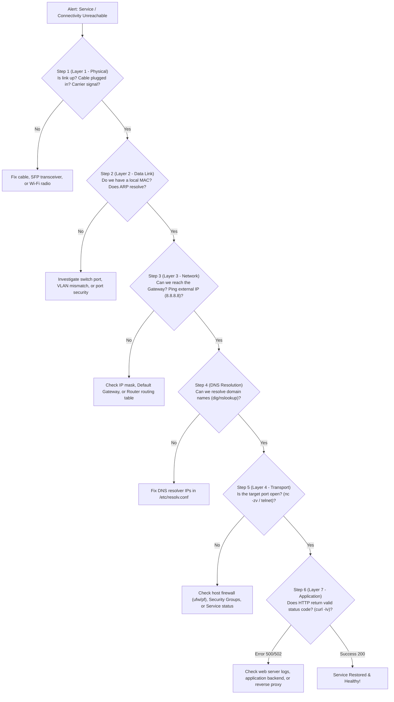

---
tags:
  - networking
  - troubleshooting
  - sysadmin
  - playbook
  - diagnostics
aliases:
  - Network Troubleshooting Playbook
  - 7-Layer Diagnostic Workflow
date_created: 2026-10-11
---

# 🩺 Playbook: Systematic 7-Layer Network Troubleshooting

> [!ABSTRACT] Executive Overview
> When an outage strikes ("The internet is down" or "Database connection timed out"), junior engineers guess randomly. Senior network architects follow the **Deterministic OSI Bottom-Up Diagnostic Workflow** to isolate the failing layer within minutes.

---

## 1. The Systematic Bottom-Up Diagnostic Flowchart



---

## 2. Step-by-Step Diagnostic Commands Reference

### Step 1: Layer 1 (Physical Link Check)
```bash
# macOS
ifconfig en0 | grep "status:"
# Linux
ip link show eth0
ethtool eth0 | grep "Link detected:"
```
* **Expected:** `status: active` or `Link detected: yes`.
* **If Inactive:** Check patch cable, verify switch port LED, test with a known good cable.

---

### Step 2: Layer 2 (Data Link & ARP Check)
```bash
# Verify your machine can resolve the default gateway MAC address
arp -n $(netstat -rn -f inet | grep 'default' | head -n 1 | awk '{print $2}')
```
* **Expected:** Gateway IP associated with a valid hex MAC address (e.g., `3c:37:12:dd:ee:ff`).
* **If Failed (`incomplete` or missing):** Check if switch port is configured with the correct VLAN, or if 802.1X port authentication has quarantined the port.

---

### Step 3: Layer 3 (IP Routing & Gateway Reachability)
```bash
# 1. Ping the local default gateway (Tests internal LAN)
ping -c 3 $(netstat -rn -f inet | grep 'default' | head -n 1 | awk '{print $2}')

# 2. Ping a public external IP (Tests WAN routing without DNS)
ping -c 3 1.1.1.1
```
* **If Gateway fails:** Local IP / subnet mask misconfigured, or gateway router is down.
* **If Gateway succeeds but 1.1.1.1 fails:** Local network is healthy, but WAN link / ISP connection is broken, or NAT has failed.

---

### Step 4: Layer 7 DNS Subsystem Check
```bash
# Query domain resolution using local configured resolver
dig +short example.com

# Test resolving directly against Cloudflare public DNS (Bypasses local resolver)
dig +short example.com @1.1.1.1
```
* **If local fails but 1.1.1.1 succeeds:** Your local router or corporate DNS server is down. Update DNS settings in `/etc/resolv.conf` or DHCP server scope.

---

### Step 5: Layer 4 Transport & Firewall Check
```bash
# Test if the remote TCP port is accepting handshakes
nc -zv -w 3 example.com 443

# Check if the local process is actually listening on the expected port
lsof -nP -iTCP -sTCP:LISTEN | grep 443
```
* **If Connection Refused:** The remote server is online, but the service daemon (Nginx, Apache) is stopped.
* **If Connection Timed Out:** A firewall (iptables, pf, AWS Security Group) is silently dropping packets.

---

### Step 6: Layer 7 Application & TLS Check
```bash
# Fetch full HTTP headers and TLS handshake details
curl -Iv https://example.com 2>&1 | head -n 30
```
* **`502 Bad Gateway`:** Reverse proxy (Nginx) is alive, but upstream backend application is crashing.
* **`504 Gateway Timeout`:** Upstream application server is overloaded or hung.
* **`SSL certificate problem`:** Expired certificate, mismatched domain name (SNI), or missing intermediate CA bundle.
