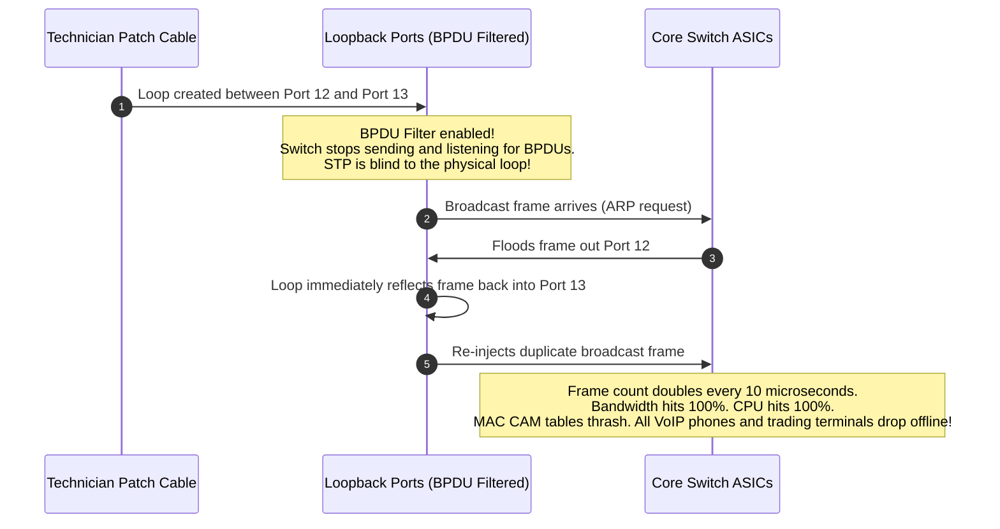
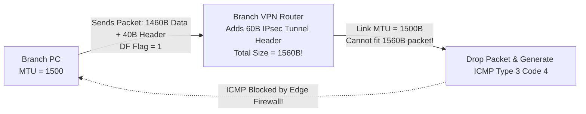

---
tags:
  - networking
  - security
  - scenarios
  - interview-prep
  - architecture
aliases:
  - Enterprise Networking Scenarios
  - System Design Networking
date_created: 2026-10-11
---

# 🏢 Enterprise Networking Case Studies & Incident Scenarios

> [!ABSTRACT] Executive Overview
> Real-world networking mastery requires applying theoretical concepts to complex production failure modes. This note analyzes four comprehensive enterprise engineering case studies, walking through architecture, failure symptoms, root causes, and production remediation.

---

## Case Study 1: The Broadcast Storm That Took Down a Trading Floor

### Architectural Setup
* A financial firm deployed 4 redundant Cisco Catalyst core switches interconnected with 10 Gbps fiber links for high availability.
* Spanning Tree Protocol (RSTP - 802.1w) was active across all VLANs.

### The Incident
During a maintenance window, a technician accidentally connected a patch cable between two access switch ports that had `spanning-tree bpdufilter enable` manually configured by an earlier contractor.

### The Failure Cascade


### Remediation & Architectural Hardening:
1. **Immediate Emergency Action:** Pull the patch cable physically to break the loop.
2. **Hardening Standard:** Enable **BPDU Guard** globally (`spanning-tree portfast bpduguard default`). If any unauthorized BPDU or looped frame is detected on an edge port, the switch automatically puts the port into `err-disable` state within milliseconds, isolating the mistake.

---

## Case Study 2: Path MTU Discovery (PMTUD) Black Hole

### The Incident
Users at a remote corporate branch office reported that they could connect to their cloud ERP web portal and load small text pages, but whenever they attempted to download a 5 MB PDF or upload an expense receipt, the browser connection hung indefinitely until timing out.

### Root Cause Analysis



1. The client sent packets with the **DF (Don't Fragment)** bit set to 1.
2. The packets passed through an IPsec VPN tunnel, which added 60 bytes of cryptographic encapsulation headers, expanding the packet to 1560 bytes.
3. The next router along the WAN path had a standard MTU of 1500. Because DF was set to 1, the router dropped the packet and generated an `ICMP Type 3 Code 4 (Fragmentation Needed and DF Set)` message back to the client.
4. **The Flaw:** An overly aggressive firewall administrator had configured a global rule blocking all ICMP traffic (`block in proto icmp`), dropping the error message!
5. The client never knew its packets were being dropped, retransmitted indefinitely, and timed out. This is a classic **PMTUD Black Hole**.

### Production Fix:
1. Allow `ICMP Type 3 Code 4` through the perimeter firewall.
2. Configure **TCP MSS Clamping** on the VPN router:
   ```text
   interface Tunnel1
    ip tcp adjust-mss 1360
   ```
   *This forces connecting TCP clients to advertise a smaller Maximum Segment Size during the 3-way handshake, preventing packets from exceeding the tunnel MTU.*

---

## Case Study 3: The Cloud Security Group Asymmetric Routing Trap

### The Scenario
A DevOps team deployed a high-availability web cluster in AWS:
* Internet-facing Application Load Balancer (ALB) in a Public Subnet.
* Web backend EC2 instances in a Private Subnet.
* A Network Address Translation (NAT) Gateway providing outbound Internet access to private instances.

### The Symptom
Backend instances could successfully reach external APIs (e.g., Stripe, GitHub) to fetch packages. However, when the ALB sent HTTP health checks to the instances, the health checks **timed out**, marking all instances unhealthy.

### Root Cause:
* The EC2 instance security group allowed outbound traffic to `0.0.0.0/0`, but lacked an inbound rule for the ALB's security group on port 8080.
* Even though Security Groups are stateful for initiated connections, they **block unsolicited inbound connections** unless explicitly whitelisted!
* **Fix:** Add an inbound rule to the EC2 Security Group:  
  `Type: Custom TCP | Port: 8080 | Source: sg-alb12345 (ALB Security Group ID)`.
